# Tuto

**Tuto – Lernen zum Verstehen.**
Vom Unterricht zur Hausaufgabe zum Verstehen.

Tuto ist eine Lernplattform für Schulen (Laravel 13, Filament 5, PHP 8.4). Mehrere Schulen laufen auf einer Installation und sehen nichts voneinander. Die Oberfläche ist auf Deutsch, die Anrede ist „du“. Eine englische Oberfläche lässt sich pro Konto einschalten.

## Live-Demo

**[hackathon.sebastian-bleuel.de](https://hackathon.sebastian-bleuel.de/)** – zum Ausprobieren mit vorausgefüllten Demodaten für jede Rolle: Stunden in jedem Zustand, Hausaufgaben mit Abgaben und Auswertung, Lernstände, Klassenbuch, Vertretung, Rückfragen und Einwilligungen. Auf der Anmeldeseite füllt ein Klick unter „Demo-Zugänge“ die Anmeldedaten aus. Das Passwort ist für alle Zugänge `hackathon2026`.

| Rolle | Benutzername | Was du dort siehst |
| --- | --- | --- |
| Plattform-Administration | `hackathon` | alle registrierten Schulen, Administrationszugänge, Kompetenzraster |
| Schuladministration | `schulleitung` | Gesamtschule am Lernpark: Benutzer, Klassen, Einwilligungen, AVV, KI-Freischaltung |
| Lehrkraft | `lehrer` (Frau Schulze) | Klasse 7b: Heute, Unterrichtsstunden, Hausaufgaben, Klassenbuch, Lernstand, Rückfragen |
| Schüler | `schueler` (Emilian) | Hausaufgaben, „Erklär’s mir“, Mein Lernstand, Rückfragen |

Alle Demo-Zugänge und was die zweite Demo-Schule zeigt, stehen im [Schnellstart](#2-schnellstart).

Diese Anleitung erklärt jede Funktion Schritt für Schritt: Du siehst, wo du klickst und was du danach findest.

**Inhalt**

1. [Was ist Tuto?](#1-was-ist-tuto)
2. [Schnellstart](#2-schnellstart)
3. [Rollen und Rechte](#3-rollen-und-rechte)
4. [Schritt für Schritt: So geht’s](#4-schritt-für-schritt-so-gehts)
   - [4.1 Für alle: Anmelden, Orientierung, Profil, Sprache](#41-für-alle-anmelden-orientierung-profil-sprache)
   - [4.2 Plattform-Administration](#42-plattform-administration)
   - [4.3 Schuladministration](#43-schuladministration)
   - [4.4 Lehrkraft](#44-lehrkraft)
   - [4.5 Schüler:in](#45-schülerin)
   - [4.6 Eltern](#46-eltern)
5. [Datenschutz](#5-datenschutz)
6. [Betrieb](#6-betrieb)
7. [App-Anbindung](#7-app-anbindung)
   - [7.1 Für Lehrkräfte: App verbinden und Zugang entziehen](#71-für-lehrkräfte-app-verbinden-und-zugang-entziehen)
   - [7.2 Für App-Entwickler:innen](#72-für-app-entwicklerinnen)

---

## 1. Was ist Tuto?

Eine Lehrkraft hält eine Stunde und trägt ein, was dran war: Notizen, ein Tafelbild, Fotos von Arbeitsblättern. Tuto macht daraus in Sekunden einen Entwurf für die Hausaufgabe, und die Lehrkraft gibt ihn frei. Der Rest läuft von allein:

- **Hausaufgabe, die eine Allerwelts-KI nicht lösen kann.** Der Entwurf besteht aus einer Zusammenfassung der Stunde und fünf Fragen: zwei zum Verständnis, zwei zur Anwendung und eine Reflexionsfrage zu einem konkreten Moment der Stunde (mit Datum). Wer nicht dabei war, kann sie nicht beantworten, auch keine KI, die den Unterricht nicht erlebt hat.
- **In eigenen Worten.** Die Schüler:innen lesen zuerst die Zusammenfassung ihrer Lehrkraft, beantworten dann die Fragen und schreiben zum Schluss selbst auf, was in der Stunde wichtig war. Wörtlich Abgeschriebenes wird abgelehnt.
- **Stufen und Einfache Sprache.** Jede Frage kann es in den Stufen „Einstieg“, „Standard“ und „Profi“ geben. Wer es braucht, schaltet die Texte der Lehrkraft auf „Einfache Sprache“.
- **Tuto prüft, ob es verstanden wurde.** Die KI bewertet jede Abgabe (Wert von 0 bis 100, Rückmeldung, Lücken). Der Wert ist eine Einschätzung und keine Note.
- **Erklär’s mir.** Lernen durch Lehren: Die Schüler:innen erklären einem neugierigen KI-Lernpartner ein Thema, der gezielt nachfragt, und bekommen danach eine Auswertung.
- **Kompetenzraster.** Alle Fragen lassen sich Kompetenzen eines gemeinsamen Referenzrahmens zuordnen (Sekundarstufe I). Die Lehrkraft sieht je Klasse und je Schüler:in, wo es noch hakt, und verteilt mit einem Klick eine Förderaufgabe.
- **Tuto-Mikro.** Die Lehrkraft schaltet in der Stunde ihr Mikrofon ein („Mikro an“) und bekommt danach Notizen aus der Stunde, eine Zusammenfassung, Kernbegriffe, einen Tafelbild-Vorschlag und die Fragen aus der Klasse. Die Klasse sieht am Beamer, ob das Mikro an oder aus ist. Es geht nur mit Einwilligung aller Anwesenden, und der Ton wird nicht gespeichert.
- **Rund um den Schulalltag.** Klassenbuch mit Entwurf aus der Stunde, Vertretung mit Übergabe-Mappe, Rückfragen der Schüler:innen an die Lehrkraft, Einstieg für die nächste Stunde, Bericht für das Elterngespräch und eine Glocke, die über Neues informiert.
- **Datenschutz von Anfang an.** Namen werden ersetzt, bevor ein Text zur KI geht. Jede Schule entscheidet selbst, ob die KI überhaupt benutzt wird. Der Ton wird nicht gespeichert. Lerndaten werden zum Ende des Schuljahres gelöscht. Mehr dazu in [Abschnitt 5](#5-datenschutz).

<p align="center">
  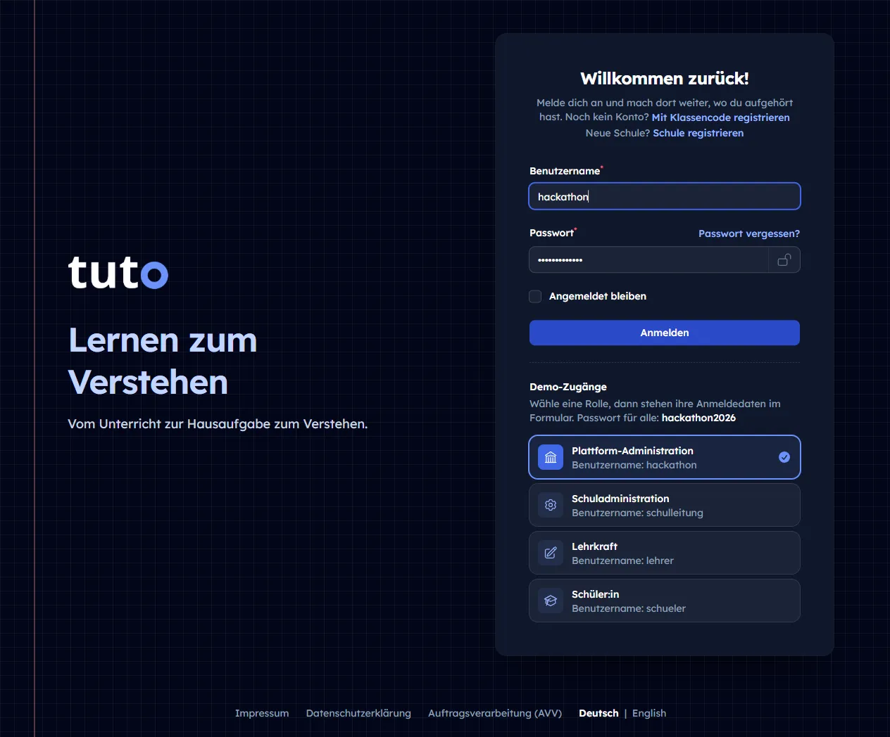<br>
  <sub>Anmeldeseite mit den Demo-Zugängen</sub>
</p>

---

## 2. Schnellstart

### Voraussetzungen

- PHP 8.4 mit den üblichen Laravel-Erweiterungen, zusätzlich `intl` (und `pdo_mysql`, wenn du MariaDB oder MySQL benutzt)
- Composer 2
- Node.js 22 mit npm
- eine Datenbank: SQLite (in der Vorlage voreingestellt) oder MariaDB/MySQL

### Installieren

```bash
git clone https://github.com/SloppifAI/Laravel_Plattform.git tuto
cd tuto

composer install
cp .env.example .env
php artisan key:generate
```

Wenn du SQLite benutzt, lege die leere Datenbankdatei an (`touch database/database.sqlite`, unter Windows PowerShell `New-Item database/database.sqlite`).

Danach die Einstellungen in der `.env` anpassen, siehe nächster Abschnitt, und weiter:

```bash
php artisan migrate        # Tabellen anlegen
php artisan db:seed        # Kompetenzraster, Plattform-Zugang und zwei Demo-Schulen
npm install
npm run build              # Oberfläche bauen (Vite, Tailwind)
php artisan serve          # http://localhost:8000
```

Kurzform: `composer run setup` erledigt Installation, `.env`, Schlüssel, Migration und den Bau der Oberfläche in einem Zug (das Seeden bleibt ein eigener Schritt). Zum Entwickeln startet `composer run dev` Server, Queue-Listener und Vite zusammen.

Beim Seeden entstehen die [Demo-Zugänge](#demo-zugänge). Das Seeden ist wiederholbar: Stunden und Gespräche der Demo werden nur angelegt, wenn sie fehlen, Änderungen daran bleiben also erhalten. Die Demo-Konten dagegen werden bei jedem Lauf zurückgesetzt, auch ihre Passwörter.

### Einstellungen in der `.env`

```dotenv
APP_NAME=Tuto
APP_URL=http://localhost:8000
APP_LOCALE=de
LERNPLATTFORM_LOCALE=de

# Datenbank: SQLite (Standard der Vorlage) ...
DB_CONNECTION=sqlite
# ... oder MariaDB/MySQL
# DB_CONNECTION=mariadb
# DB_HOST=127.0.0.1
# DB_PORT=3306
# DB_DATABASE=tuto
# DB_USERNAME=tuto
# DB_PASSWORD=geheim

# E-Mail: "log" schreibt Mails nur ins Log. Für das Zurücksetzen von Passwörtern per Mail einen echten Versand eintragen.
MAIL_MAILER=log
# MAIL_MAILER=smtp
# MAIL_HOST=smtp.example.org
# MAIL_PORT=587
# MAIL_USERNAME=...
# MAIL_PASSWORD=...
# MAIL_FROM_ADDRESS=tuto@example.org

# KI (siehe unten). Ohne Schlüssel läuft Tuto komplett offline mit der Demo-Logik.
GEMINI_API_KEY=
# AI_ENABLED=true
# AI_PROVIDER=gemini

# Vertrag zur Auftragsverarbeitung (AVV): Standard ist true (freigegeben). Nur false macht ihn zum Entwurf,
# den Schulen lesen, aber nicht annehmen können.
# LERNPLATTFORM_DPA_FINAL=false
```

| Variable | Standard | Bedeutung |
| --- | --- | --- |
| `APP_LOCALE`, `LERNPLATTFORM_LOCALE` | `en` in der Vorlage, `de` im Programm | Standardsprache der Oberfläche (`de` oder `en`). Sie gilt, bis jemand auf der Anmeldeseite oder im Profil eine andere Sprache wählt. Entscheidend ist `LERNPLATTFORM_LOCALE` (Standard `de`). Setze beide auf `de`, dann ist alles stimmig. |
| `AI_ENABLED` | `true`, sobald `GEMINI_API_KEY` gefüllt ist | Plattformschalter für die KI. Bei `false` antwortet überall die Demo-Logik. |
| `AI_PROVIDER` | `gemini` | Anbieter der KI (Laravel AI SDK). Weitere Anbieter stehen in `config/ai.php`. |
| `AI_MODEL` | leer | Modell des Anbieters. Leer heißt: Standardmodell des Anbieters. |
| `AI_TRANSCRIPTION_MODEL` | leer | Modell für die Spracherkennung beim Tuto-Mikro. Leer heißt: Standardmodell des Anbieters. |
| `AI_TIMEOUT` | `120` | Sekunden, die die KI für eine Antwort hat. |
| `GEMINI_API_KEY`, `GEMINI_URL` | leer, Google-Adresse | Zugang zu Google Gemini. |
| `OLLAMA_URL`, `OLLAMA_API_KEY` | `http://localhost:11434`, leer | Zugang zu einem lokalen Modell mit Ollama. |
| `LERNPLATTFORM_DPA_FINAL` | `true` | Ob der AVV freigegeben ist. Bei `false` ist er ein Entwurf: Schulen können ihn lesen, aber noch nicht annehmen. |
| `LERNPLATTFORM_SCHOOL_YEARS_KEPT` | `1` | Wie viele Schuljahre Lerndaten bleiben (1 = nur das laufende). |
| `LERNPLATTFORM_SCHOOL_YEAR_STARTS` | `08-01` | Beginn des Schuljahres (Monat-Tag). Dann wird gelöscht. |
| `LERNPLATTFORM_ONE_YEAR_RULE_FROM` | `2027-08-01` | Bis zu diesem Tag bleiben noch zwei Schuljahre gespeichert, weil bisherige Verträge das versprechen. |
| `LERNPLATTFORM_MIKRO_SESSION_KEEP_DAYS` | `365` | Wie lange der Nachweis je Tuto-Mikro-Sitzung (Zeit, Dauer, Anwesenheit) bleibt. |
| `LERNPLATTFORM_MIKRO_MAX_SEGMENT_KB` | `2048` | Größte erlaubte Größe eines Ton-Abschnitts. |
| `LERNPLATTFORM_SUBSTITUTION_MAX_DAYS` | `90` | Wie viele Tage dieselbe Lehrkraft eine Klasse insgesamt vertreten darf. |
| `LERNPLATTFORM_NOTIFICATIONS_KEEP_READ_DAYS`, `LERNPLATTFORM_NOTIFICATIONS_KEEP_DAYS` | `14`, `60` | Wie lange gelesene und alle Meldungen der Glocke bleiben. |
| `LERNPLATTFORM_APP_REDIRECT_URIS` | `tutoapp://callback` | Adressen, zu denen Tuto nach dem Verbinden einer App zurückleitet (kommagetrennt, genau so, wie die App sie angibt). Siehe [App-Anbindung](#72-für-app-entwicklerinnen). |
| `SANCTUM_EXPIRATION` | `259200` | Wie lange der Zugang einer verbundenen App gilt, in Minuten (259200 sind 180 Tage). `0` schaltet das Ablaufen ab, das ist nicht zu empfehlen. |

### KI einschalten: zwei Schalter

Texte einer Schule gehen nur zur KI, wenn **beide** Schalter an sind:

1. **Plattform:** `AI_ENABLED=true` (oder ein gefüllter `GEMINI_API_KEY`) in der `.env`.
2. **Schule:** Die Schuladministration bestätigt die Checkliste und schaltet die KI unter Verwaltung → KI-Funktionen ein ([so geht’s](#ki-funktionen-freischalten)).

Fehlt einer der beiden, antwortet die **Demo-Logik** auf der Plattform: Entwürfe und Auswertungen entstehen offline, nichts verlässt den Server. Die Demo-Logik versteht Inhalte nicht wirklich, ihre Entwürfe sind nur Beispiele und ihre Werte nur grobe Anhaltspunkte. Tuto sagt das an den passenden Stellen ausdrücklich („Demo-Modus“).

**Gemini (Standard):** `GEMINI_API_KEY` eintragen, `AI_PROVIDER=gemini` ist der Standard. Für echte Schuldaten brauchst du einen bezahlten Tarif, bei dem Eingaben nicht zur Produktverbesserung genutzt werden. Die Schule bestätigt das in ihrer Checkliste.

**Lokales Modell mit Ollama:**

```dotenv
AI_ENABLED=true
AI_PROVIDER=ollama
AI_MODEL=<Name deines Modells>
OLLAMA_URL=http://localhost:11434
```

Dann verlässt kein Text deinen Server. Was ein lokales Modell kann, hängt vom Modell ab: Das Lesen von Arbeitsblatt-Fotos und die Spracherkennung beim Tuto-Mikro brauchen Fähigkeiten, die nicht jedes Modell hat.

### Zeitplaner und Queue

Tuto räumt täglich auf (Lerndaten zum Schuljahresende, Nachweise des Tuto-Mikro, alte Meldungen, abgelaufene Passwort-Links, abgelaufene Zugänge verbundener Apps). Dafür muss der Laravel-Zeitplaner laufen:

```cron
* * * * * cd /pfad/zu/tuto && php artisan schedule:run >> /dev/null 2>&1
```

In Containern oder zum Ausprobieren: `php artisan schedule:work`. Details stehen in [Abschnitt 6](#6-betrieb).

Einen Queue-Worker braucht Tuto aktuell nicht: Es gibt keine Jobs in der Warteschlange.

### Demo-Zugänge

Alle Demo-Konten haben das Passwort **`hackathon2026`**. Auf der Anmeldeseite wählst du unter „Demo-Zugänge“ eine Rolle, dann stehen die Anmeldedaten schon im Formular.

| Benutzername | Rolle | Person | Schule und Klasse |
| --- | --- | --- | --- |
| `hackathon` | Plattform-Administration | Hackathon | gehört zu keiner Schule |
| `schulleitung` | Schuladministration | Petra Krause | Gesamtschule am Lernpark (Fulda) |
| `lehrer` | Lehrkraft | Frau Schulze | Klassenleitung 7b |
| `weber` | Lehrkraft | Thomas Weber | Klassenleitung 7a, unterrichtet auch 7b |
| `schueler` | Schüler:in | Emilian | Klasse 7b |
| `ben.krueger`, `lena.schulz`, `jonas.becker`, `elif.yilmaz`, `noah.wagner`, `emma.fischer`, `luca.meyer` | Schüler:innen | Ben Krüger, Lena Schulz, Jonas Becker, Elif Yılmaz, Noah Wagner, Emma Fischer, Luca Meyer | Klasse 7b |
| `paul.richter`, `hannah.koch`, `leon.wolf`, `sophie.neumann` | Schüler:innen | Paul Richter, Hannah Koch, Leon Wolf, Sophie Neumann | Klasse 7a |
| `gym-admin` | Schuladministration | Stefan Brandt | Gymnasium Musterstadt |
| `gym-lehrer` | Lehrkraft | Julia Berger | Gymnasium Musterstadt, Klasse 8c |
| `gym-schueler1`, `gym-schueler2` | Schüler:innen | Finn Albrecht, Clara Vogt | Gymnasium Musterstadt, Klasse 8c |

Was die Demo-Schule „Gesamtschule am Lernpark“ mitbringt: Stunden in jedem Zustand (Entwurf, Hausaufgabe mit Ergebnissen, offene Hausaufgabe, Hausaufgabe für ausgewählte Schüler:innen, eine offene Förderaufgabe für Emilian und Ben), „Erklär’s mir“-Gespräche von Emilian, Klassenbuch-Einträge, eine laufende Vertretung durch Thomas Weber, Rückfragen von Emilian und Meldungen in der Glocke. Die KI ist für die Schule schon freigeschaltet (sie läuft aber erst, wenn auch der Plattformschalter an ist) und der AVV ist angenommen. Das Tuto-Mikro ist **nicht** freigeschaltet: Wie du es einrichtest, steht in [Tuto-Mikro für die Schule freischalten](#tuto-mikro-für-die-schule-freischalten). Das Gymnasium Musterstadt ist klein und zeigt, was Schulen voneinander nicht sehen.

---

## 3. Rollen und Rechte

Es gibt vier Rollen. Die Rechte hängen allein an der Rolle eines Kontos. Alle außer der Plattform-Administration gehören genau zu einer Schule und sehen nur diese.

| Rolle | Wofür | Sieht keine … |
| --- | --- | --- |
| **Plattform-Administration** | Betreut die Plattform: Schulen ansehen und sperren, Administrationskonten anlegen, Kompetenzraster pflegen. | Unterrichts- und Lerndaten |
| **Schuladministration** | Verwaltet Benutzer, Klassen und Einstellungen der eigenen Schule und sieht alle Auswertungen dieser Schule. | Daten anderer Schulen |
| **Lehrkraft** | Erfasst Stunden, gibt Hausaufgaben frei, sieht die Ergebnisse der eigenen Stunden und den Lernstand der Klassen, die sie unterrichtet. | Daten von Klassen, die sie nicht unterrichtet |
| **Schüler:in** | Bearbeitet freigegebene Hausaufgaben, übt mit Erklär’s mir, stellt Rückfragen. | Daten anderer Schüler:innen |

Wer eine Klasse „unterrichtet“, ist Klassenleitung, wurde der Klasse zugeordnet oder vertritt sie im Zeitraum einer Vertretung. Wer nur einmal eine Stunde dort gehalten hat, gehört nicht dazu.

| Was | Plattform-Admin. | Schuladmin. | Lehrkraft | Schüler:in |
| --- | --- | --- | --- | --- |
| Schulen ansehen, Stammdaten pflegen, sperren | ja | nur Stammdaten der eigenen Schule | – | – |
| Benutzer verwalten | nur Administrationskonten | alle Konten der eigenen Schule | – | – |
| Klassen verwalten, Schülerliste importieren | – | eigene Schule | – | – |
| Kompetenzraster | pflegen | nachschlagen | nachschlagen | – |
| Stunden erfassen, Hausaufgaben freigeben | – | alle Stunden der eigenen Schule | eigene Stunden, in Klassen, die sie unterrichtet | – |
| Heute: Hausaufgaben prüfen und freigeben | – | – | eigene | – |
| Ergebnisse, Abgaben, Erklär’s-mir-Gespräche ansehen | keine Lerndaten | eigene Schule | eigene Stunden und Klassen, die sie unterrichtet | nur eigene |
| Klassenbuch | – | eigene Schule: Entwürfe aus jeder Stunde erstellen, bearbeiten und bestätigen, bestätigte Einträge wieder öffnen | Klassen, die sie unterrichtet: Einträge der eigenen Stunden bearbeiten und bestätigen, die Einträge der übrigen Lehrkräfte der Klasse lesen und exportieren | – |
| Vertretung einrichten | – | jede Klasse der Schule | Klassenleitung, für die eigene Klasse | – |
| Rückfragen | – | eigene Schule | eigene Stunden | eigene |
| Hausaufgaben bearbeiten, Erklär’s mir | – | – | – | ja |
| Tuto-Mikro in der Stunde einschalten | – | nein | ja, in Klassen, die sie unterrichtet | – |
| Tuto-Mikro und KI für die Schule freischalten | – | ja | – | – |
| Einwilligungen der Eltern erfassen | – | alle Klassen der Schule | Klassen, die sie unterrichtet | eigene Zustimmung, wo die Schule sie verlangt |
| Benachrichtigungen (Glocke) | – | – | ja | ja |

Die Matrix mit allen Zeilen und Erklärungen findest du in der Anwendung unter **Rollen & Rechte** (Plattform-Administration: Plattform → Rollen & Rechte, Schuladministration: Verwaltung → Rollen & Rechte).

<p align="center">
  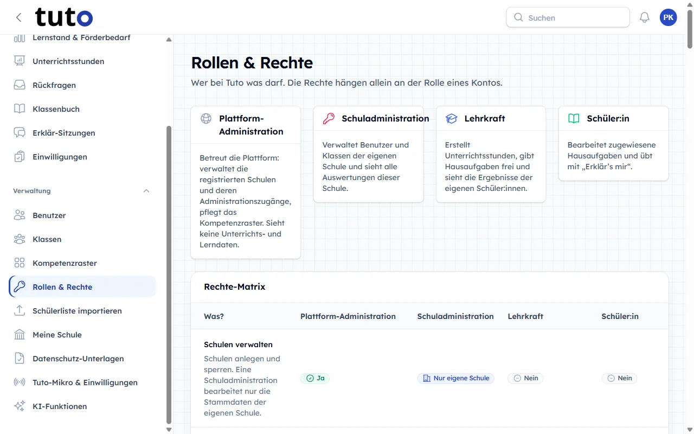<br>
  <sub>Die Rechte-Matrix unter Rollen &amp; Rechte</sub>
</p>

---

## 4. Schritt für Schritt: So geht’s

Die Seitenleiste links ist in vier Gruppen geordnet: **Plattform**, **Unterricht**, **Lernen** und **Verwaltung**. Du siehst nur die Einträge, die zu deiner Rolle passen. Auf dem Handy klappt die Seitenleiste ein, und Tabellen werden zu Karten, die untereinander stehen.

### 4.1 Für alle: Anmelden, Orientierung, Profil, Sprache

#### Anmelden

**So erreichst du es:** `/login`

1. Gib Benutzername und Passwort ein und klicke auf „Anmelden“.
2. Du landest auf **Mein Lernbereich**, der Startseite deiner Rolle.

Passwort vergessen? Klicke neben dem Passwortfeld auf „Passwort vergessen?“, gib Benutzername oder E-Mail-Adresse ein und klicke auf „Link zum Zurücksetzen senden“. Den Link bekommst du nur, wenn in deinem Konto eine E-Mail-Adresse steht und die Plattform Mails versenden kann. Ohne E-Mail-Adresse setzt die Schuladministration dein Passwort zurück (Verwaltung → Benutzer → bearbeiten).

#### Orientierung

- **Mein Lernbereich** ist die Startseite. Lehrkräfte sehen ihre Stunden und Kennzahlen, Schüler:innen ihre nächsten Hausaufgaben, die Schuladministration Kennzahlen und Abkürzungen zu allen Verwaltungsseiten, die Plattform-Administration die Schulen im Überblick.
- Die **Glocke** in der Kopfleiste meldet Neues, ohne Namen: Schüler:innen erfahren von neuen Hausaufgaben und Förderaufgaben und von beantworteten Rückfragen, Lehrkräfte von neuen Abgaben und neuen Rückfragen (als Anzahl je Stunde). Ein Klick auf „Öffnen“ bringt dich zur passenden Seite.
- Unten auf jeder Seite stehen Impressum, Datenschutzerklärung und Auftragsverarbeitung (AVV).
- **Datenschutz & KI** in der Seitenleiste erklärt in einfachen Worten, was gespeichert wird und wer es sieht.

#### Profil und Sprache

**So erreichst du es:** Benutzermenü oben rechts → Profil (`/profile`)

1. Hier änderst du E-Mail-Adresse, Sprache und Passwort. Für ein neues Passwort oder eine neue E-Mail-Adresse brauchst du dein aktuelles Passwort. Lehrkräfte und die Schuladministration sehen hier außerdem, welche Apps mit ihrem Konto verbunden sind, und können den Zugang entziehen ([so geht’s](#zugang-entziehen)).
2. Benutzername und Rolle ändert nur die Schulverwaltung. Schüler:innen können auch ihren Namen nicht ändern, damit niemand sich als Mitschüler:in ausgeben kann.
3. Mit **Meine Daten herunterladen** (oben rechts) bekommst du alles, was zu deinem Konto gespeichert ist, als Datei (JSON).

**Sprache wechseln (Deutsch/English):**

- Vor der Anmeldung: unten auf der Anmeldeseite auf „English“ bzw. „Deutsch“ klicken.
- Nach der Anmeldung: Benutzermenü oben rechts → „Sprache: English“ (bzw. „Sprache: Deutsch“), oder im Profil bei „Sprache“ auswählen und speichern.

Deine Wahl wird an deinem Konto gespeichert und gilt auf jedem Gerät. Texte, die noch nicht übersetzt sind, erscheinen auf Deutsch.

<p align="center">
  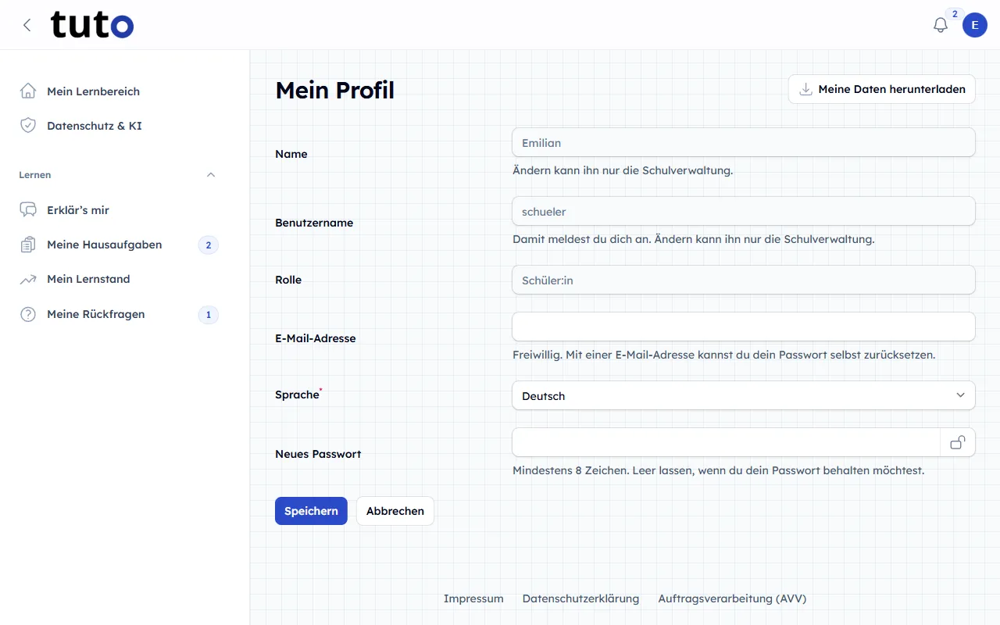<br>
  <sub>Profil mit Sprachauswahl und dem Knopf „Meine Daten herunterladen“</sub>
</p>

---

### 4.2 Plattform-Administration

Anmelden mit `hackathon`. Du siehst keine Unterrichts- und Lerndaten, nur Schulen und Zugänge.

<p align="center">
  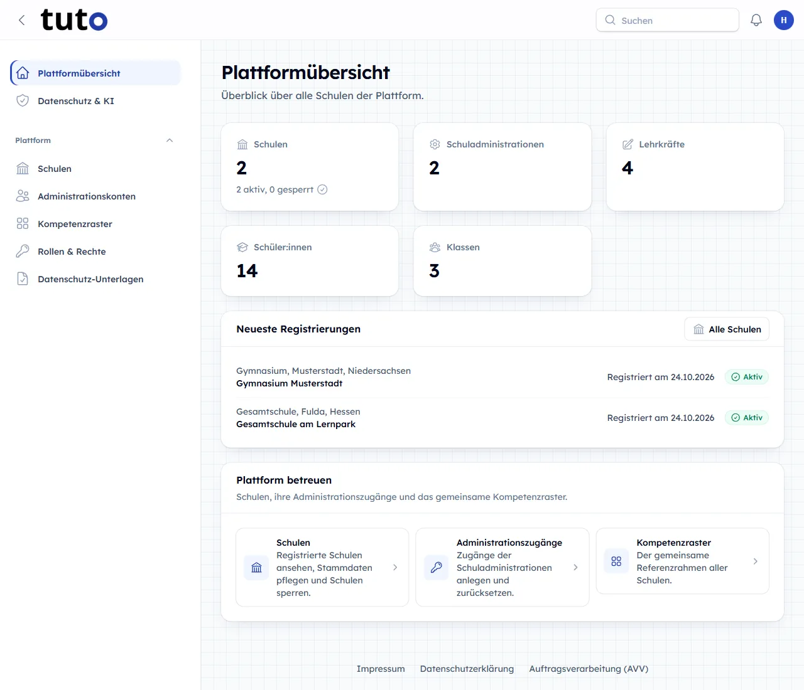<br>
  <sub>Startseite der Plattform-Administration</sub>
</p>

#### Schulen ansehen und sperren

**So erreichst du es:** Seitenleiste → Plattform → Schulen (`/schulen`)

Neue Schulen legst du nicht an: Sie registrieren sich selbst ([so geht’s](#schule-registrieren)).

1. Die Tabelle zeigt Schule, Schulnummer, Ort, Schulform, AVV-Stand, Zahl der Konten und Klassen, Registrierungsdatum und Status. Mit den Filtern oben grenzt du nach Status (Aktiv/Gesperrt) und AVV-Stand ein.
2. Klicke in der Zeile auf „Bearbeiten“, um die Stammdaten zu ändern.
3. Klicke auf „Sperren“ und bestätige mit „Ja, Schule sperren“. Danach kann sich niemand aus dieser Schule mehr anmelden, auch wer gerade angemeldet ist. Der Klassencode der Schule gilt als unbekannt.
4. „Entsperren“ in der Zeile oder oben auf der Bearbeiten-Seite macht alles wieder frei.

<p align="center">
  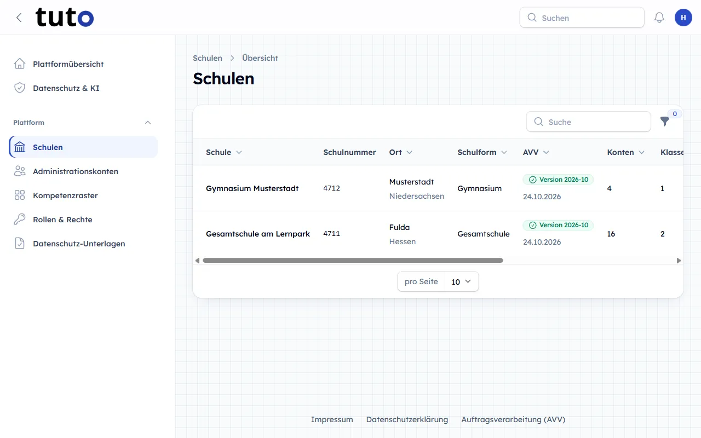<br>
  <sub>Liste der Schulen</sub>
</p>

#### Administrationskonten anlegen

**So erreichst du es:** Seitenleiste → Plattform → Administrationskonten (`/benutzer`)

1. Klicke oben rechts auf den Knopf zum Anlegen.
2. Trage Name, Benutzername, E-Mail (freiwillig) und ein Passwort ein (mindestens 8 Zeichen).
3. Wähle die Rolle „Schuladministration“ und die Schule. („Plattform-Administration“ legt ein weiteres Konto ohne Schule an. Die Rolle lässt sich danach nicht mehr ändern.)
4. Speichern. Die Schuladministration kann sich nun anmelden und Klassen, Lehrkräfte und Schüler:innen anlegen.

Hier setzt du auch das Passwort eines Administrationskontos zurück: Konto öffnen, neues Passwort eintragen, speichern.

<p align="center">
  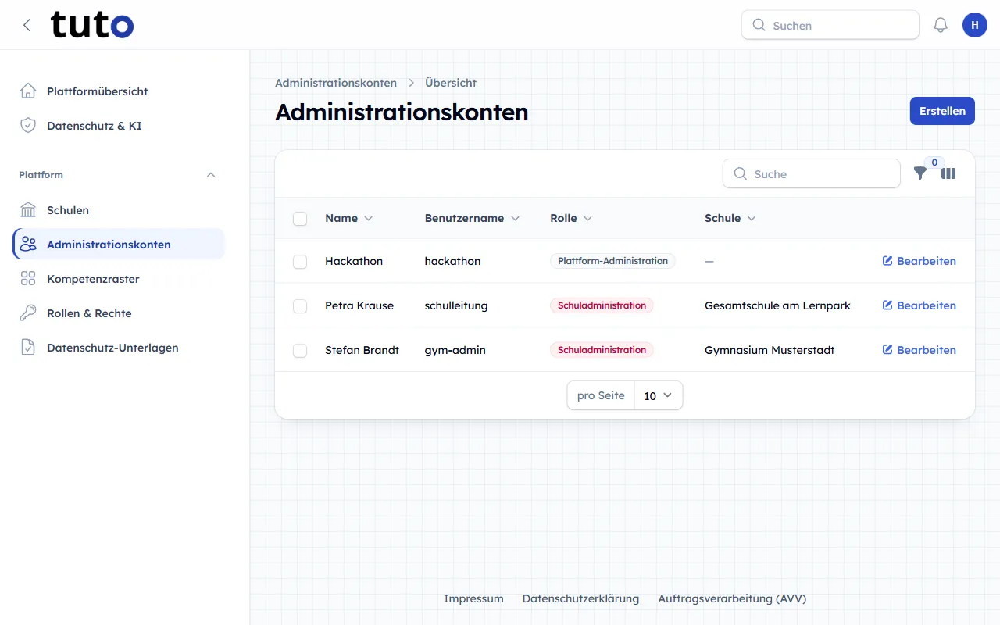<br>
  <sub>Administrationskonten</sub>
</p>

#### Kompetenzraster pflegen

**So erreichst du es:** Seitenleiste → Plattform → Kompetenzraster (`/kompetenzraster`)

Das Kompetenzraster gilt für alle Schulen. Es enthält die Prozesskompetenzen der Bildungsstandards und Lehrpläne der Sekundarstufe I (Mathematik, Deutsch, Biologie, Geschichte und weitere Fächer) sowie fachübergreifende Kompetenzen. Du legst Kompetenzen an („Fach“, „Kompetenzbereich“, „Kompetenz“, „Beschreibung“), bearbeitest oder löschst sie. Schuladministrationen und Lehrkräfte können das Raster nur nachschlagen.

<p align="center">
  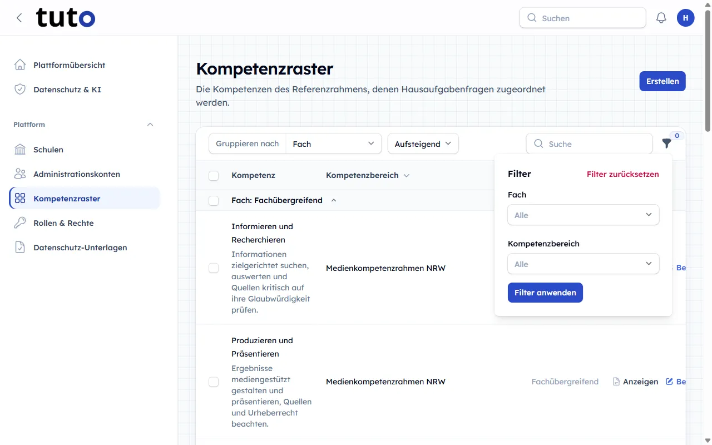<br>
  <sub>Kompetenzraster</sub>
</p>

#### Datenschutz-Unterlagen und Rollen & Rechte

Unter Plattform → Datenschutz-Unterlagen findest du dieselben Vorlagen wie die Schulen, nur ohne Schuldaten ([mehr dazu](#datenschutz-unterlagen-für-die-schule)). Plattform → Rollen & Rechte zeigt die Rechte-Matrix.

---

### 4.3 Schuladministration

Anmelden mit `schulleitung` (Demo) oder mit dem Konto, das bei der Registrierung deiner Schule entstanden ist.

<p align="center">
  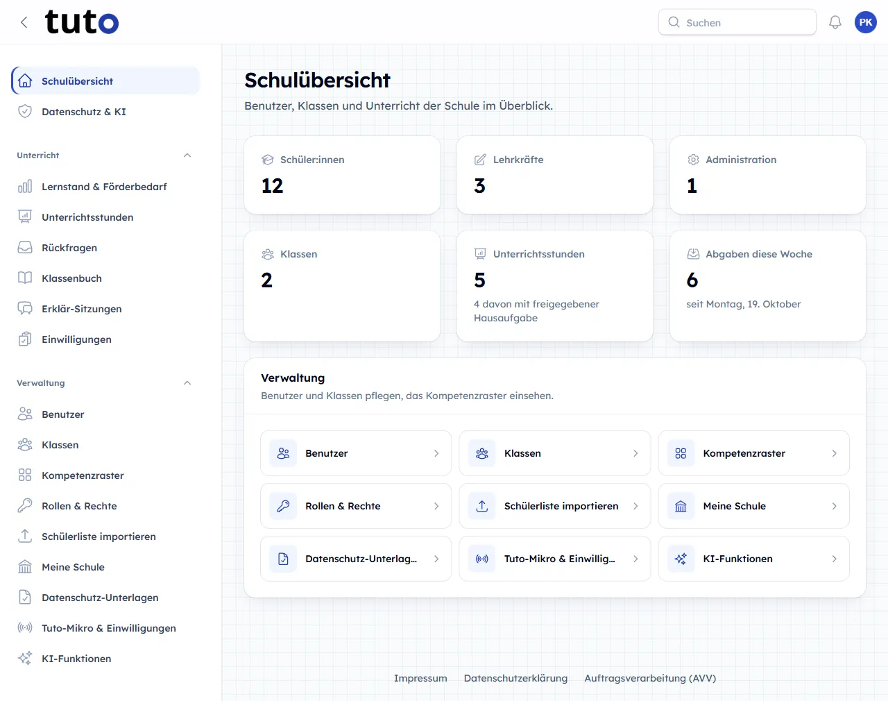<br>
  <sub>Startseite der Schuladministration</sub>
</p>

#### Schule registrieren

**So erreichst du es:** `/schule-registrieren`, oder auf der Anmeldeseite „Schule registrieren“ (neben „Neue Schule?“)

1. Trage unter „Deine Schule“ Schulname, Schulform, Ort, Bundesland und Kontakt-E-Mail der Schule ein. Die amtliche Schulnummer ist freiwillig.
2. Lege unter „Erster Zugang der Schuladministration“ dein Konto an: Name, Benutzername, E-Mail-Adresse und Passwort (zweimal).
3. Setze die Haken: „Ich bin berechtigt, die Schule zu vertreten“, die Datenschutzerklärung und, wenn der AVV freigegeben ist, „Ich akzeptiere den Auftragsverarbeitungsvertrag (AVV) im Namen der Schule“. Ist der AVV noch ein Entwurf, kannst du ihn lesen und nimmst ihn später unter „Meine Schule“ an.
4. Klicke auf „Schule registrieren“. Du bist danach angemeldet. Als Nächstes legst du Klassen an oder importierst eine Schülerliste.

<p align="center">
  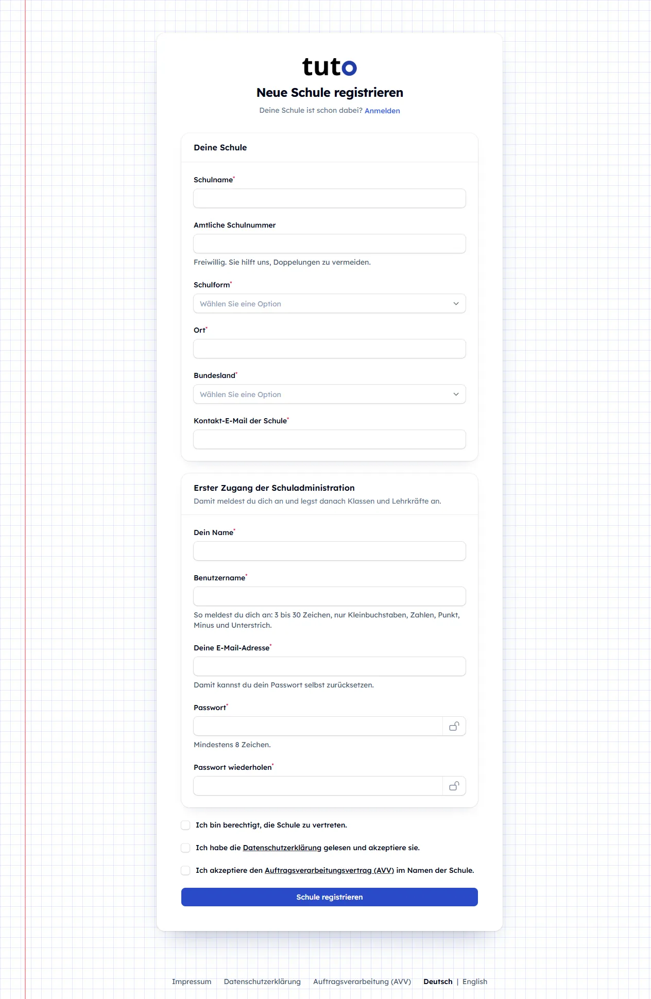<br>
  <sub>Schule registrieren</sub>
</p>

#### AVV annehmen

**So erreichst du es:** Seitenleiste → Verwaltung → Meine Schule (`/meine-schule`)

Der Vertrag zur Auftragsverarbeitung (Art. 28 DSGVO) regelt, wie Tuto die Daten deiner Schule in deinem Auftrag verarbeitet. **Solange er nicht angenommen ist, kann deine Schule nur diese Seite nutzen.** Wer den Vertrag bei der Registrierung angenommen hat, muss hier nichts tun.

1. Der Abschnitt „Auftragsverarbeitungsvertrag (AVV)“ zeigt den Stand: „Angenommen, Version …“, „Noch nicht angenommen“, „Geänderte Fassung zur Annahme“ oder „Entwurf, noch nicht annehmbar“.
2. Klicke auf „Vertrag mit den Daten deiner Schule ansehen und drucken“. Der Vertrag öffnet sich in einem neuen Tab, mit den Stammdaten deiner Schule ausgefüllt. Lies ihn zuerst.
3. Klicke auf „Vertrag annehmen“ (bei einer geänderten Fassung „Geänderte Fassung annehmen“) und bestätige mit „Im Namen der Schule annehmen“. Gespeichert werden Version, Zeitpunkt, der Vertragstext, wie du ihn gesehen hast, und dein Name mit Benutzername.
4. Später kannst du unter „Angenommene Fassung (Version …) ansehen“ nachlesen, was deine Schule angenommen hat.

Unter „Meine Schule“ pflegst du außerdem die Stammdaten der Schule (Formular unten, „Speichern“).

<p align="center">
  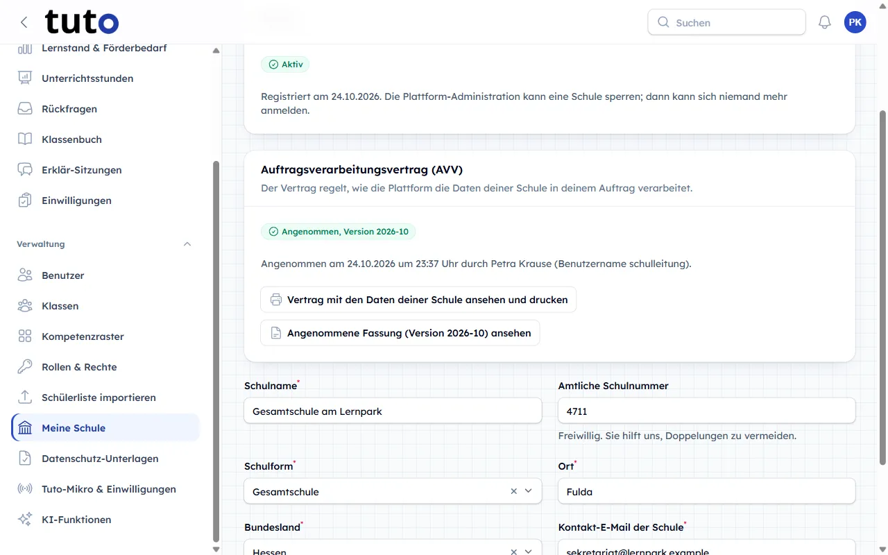<br>
  <sub>Meine Schule mit dem AVV-Abschnitt</sub>
</p>

#### KI-Funktionen freischalten

**So erreichst du es:** Seitenleiste → Verwaltung → KI-Funktionen (`/ki-funktionen`)

Standardmäßig antwortet die Demo-Logik auf der Plattform. Erst wenn du die KI für deine Schule einschaltest und die Plattform die KI aktiviert hat ([zwei Schalter](#ki-einschalten-zwei-schalter)), gehen pseudonymisierte Texte an den KI-Anbieter.

1. Lies die vier Punkte der Checkliste und hake sie ab, wenn sie für deine Schule stimmen. Die Plattform kann das nicht prüfen:
   - Auftragsverarbeitung mit dem KI-Anbieter abgeschlossen
   - Bezahlter Tarif, bei dem Eingaben nicht zur Produktverbesserung genutzt werden
   - Datenschutz-Folgenabschätzung durchgeführt
   - Eltern und Schüler:innen informiert
2. Klicke auf „Speichern“.
3. Klicke auf „KI-Funktionen einschalten“ (der Knopf ist erst aktiv, wenn alle vier Punkte abgehakt sind) und bestätige mit „Ja, einschalten“.
4. Die Seite zeigt, wer die KI wann eingeschaltet hat und welcher Anbieter genutzt wird.

Mit „KI-Funktionen ausschalten“ geht sofort nichts mehr an den Anbieter; gespeicherte Ergebnisse bleiben. Nimmst du später einen Haken zurück und speicherst, schaltet sich die KI selbst aus.

<p align="center">
  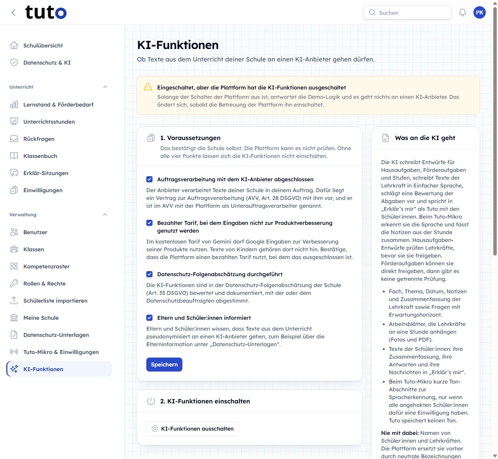<br>
  <sub>KI-Funktionen mit Checkliste</sub>
</p>

#### Benutzer anlegen

**So erreichst du es:** Seitenleiste → Verwaltung → Benutzer (`/benutzer`)

Lehrkräfte bekommen ihren Zugang von dir, sie registrieren sich nicht selbst. Schüler:innen registrieren sich mit dem Klassencode oder kommen über den Import.

1. Klicke oben rechts auf den Knopf zum Anlegen.
2. Trage Name, Benutzername (gilt auf der ganzen Plattform nur einmal), E-Mail (freiwillig) und Passwort (mindestens 8 Zeichen) ein.
3. Wähle die Rolle: Schuladministration, Lehrkraft oder Schüler:in. Bei Schüler:innen wählst du die Klasse.
4. Speichern.

Zum Bearbeiten klickst du in der Liste auf die Person. Passwort leer lassen heißt: das bisherige bleibt. Oben rechts auf der Seite gibt es „Datenauskunft“: Alle Daten zu diesem Konto als Datei (JSON), falls jemand Auskunft verlangt. Das eigene Konto kann niemand löschen.

<p align="center">
  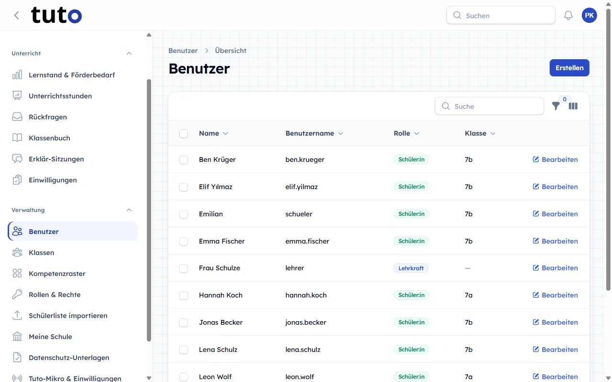<br>
  <sub>Benutzerliste der Schule</sub>
</p>

#### Klassen anlegen

**So erreichst du es:** Seitenleiste → Verwaltung → Klassen (`/klassen`)

1. Klicke oben rechts auf den Knopf zum Anlegen.
2. Gib den Namen ein (zum Beispiel „7b“, in deiner Schule nur einmal) und wähle die Klassenleitung (eine Lehrkraft deiner Schule, kann auch leer bleiben).
3. Speichern. Die Klasse bekommt automatisch einen **Klassencode**.

Die Liste zeigt je Klasse Klassenleitung, Zahl der weiteren Lehrkräfte, Klassencode (zum Kopieren) und Zahl der Schüler:innen.

<p align="center">
  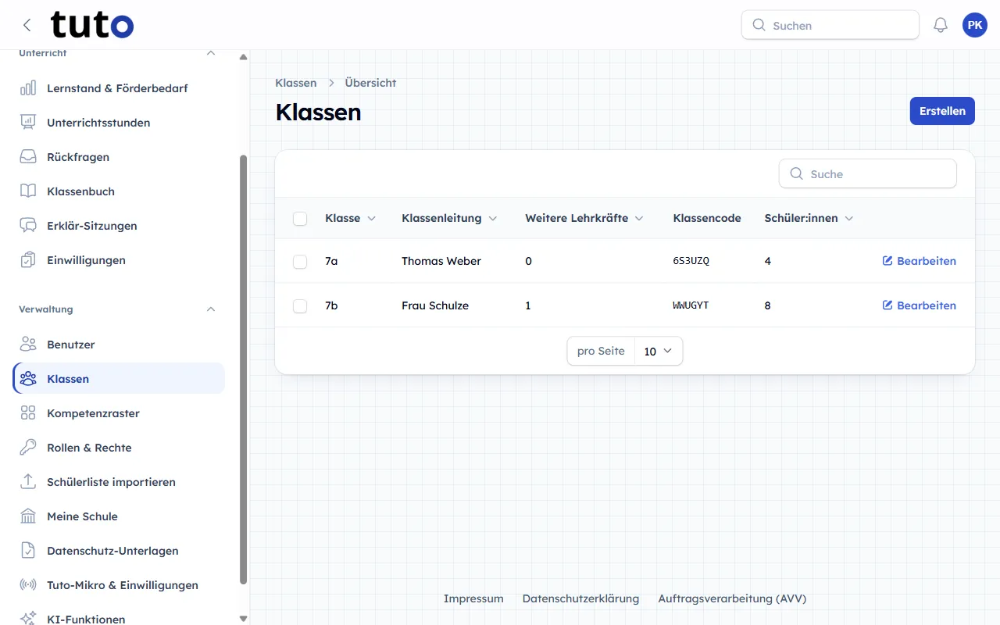<br>
  <sub>Klassenliste</sub>
</p>

#### Klassenleitung und weitere Lehrkräfte zuordnen

**So erreichst du es:** Verwaltung → Klassen → Klasse in der Liste öffnen („Bearbeiten“)

1. Die **Klassenleitung** wählst du oben im Formular bei „Klassenleitung“. Sie unterrichtet die Klasse immer.
2. Weitere Lehrkräfte ordnest du im Bereich „Unterrichtende Lehrkräfte“ zu: „Lehrkräfte hinzufügen“, Lehrkräfte auswählen (mehrere gehen), bestätigen. Mit „Nicht mehr zuordnen“ nimmst du die Zuordnung zurück.
3. Nur die Klassenleitung und zugeordnete Lehrkräfte können in dieser Klasse Stunden anlegen und die Lernstände der Klasse sehen. Fehlt die Zuordnung, bekommt die Lehrkraft die Klasse in keiner Auswahl angezeigt.

<p align="center">
  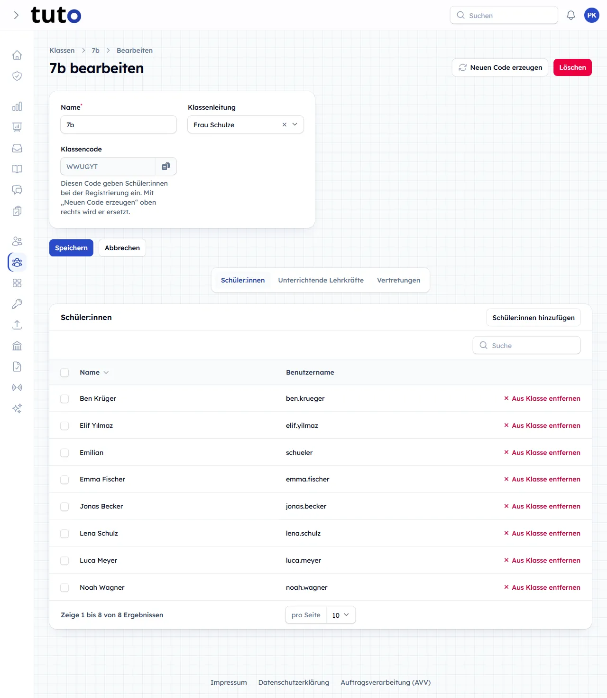<br>
  <sub>Klasse bearbeiten mit Lehrkräften, Schüler:innen und Vertretungen</sub>
</p>

#### Schüler:innen in die Klasse bringen

Es gibt drei Wege.

**a) Schülerliste importieren (empfohlen für ganze Klassen)**

**So erreichst du es:** Seitenleiste → Verwaltung → Schülerliste importieren (`/schuelerliste-importieren`)

1. Exportiere die Schülerliste aus deiner Schulverwaltung (zum Beispiel SchILD-NRW, WebUntis oder IServ) als CSV-Datei. Die erste Zeile enthält die Spaltennamen **Nachname, Vorname, Klasse**, optional **Benutzername** und **E-Mail**. Trennzeichen und Zeichenkodierung erkennt Tuto selbst.
2. Wähle die Datei (bis 1 MB, höchstens 300 Schüler:innen pro Datei) und klicke auf „Vorschau erstellen“. Noch wird nichts gespeichert.
3. Prüfe die Tabelle: Jede Zeile ist „Wird angelegt“, „Wird aktualisiert“ oder „Übersprungen“ (mit Hinweis). Fehlende Klassen werden neu angelegt. Neue Konten bekommen den Benutzernamen `vorname.nachname` und ein zufälliges Startpasswort.
4. Klicke auf „Import ausführen“ und bestätige mit „Ja, importieren“.
5. **Klicke jetzt auf „Zugangsdaten als CSV herunterladen“.** Die Startpasswörter siehst du nur dieses eine Mal, später lassen sie sich nur neu setzen.

Wer schon da ist, wird aktualisiert statt doppelt angelegt. Konten von Lehrkräften und der Administration bleiben unberührt.

<p align="center">
  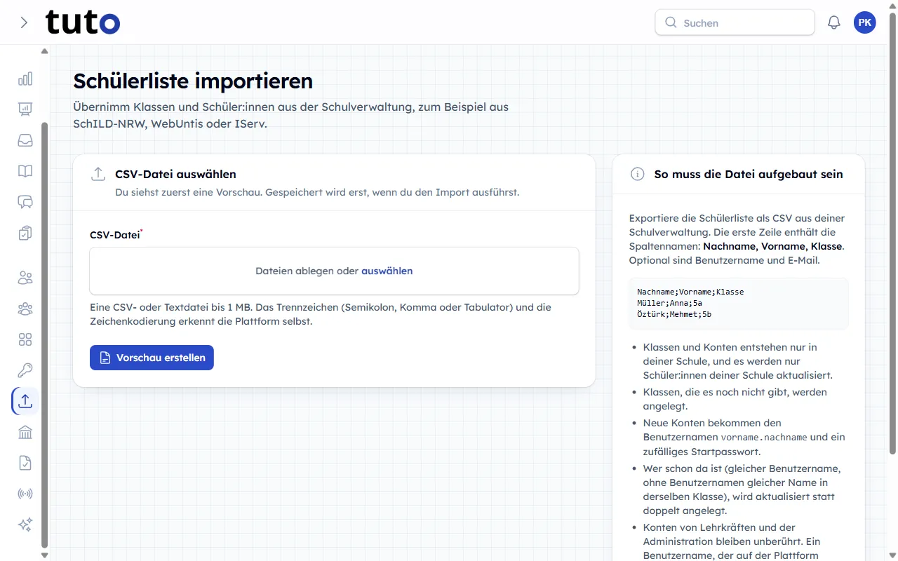<br>
  <sub>Schülerliste importieren</sub>
</p>

<p align="center">
  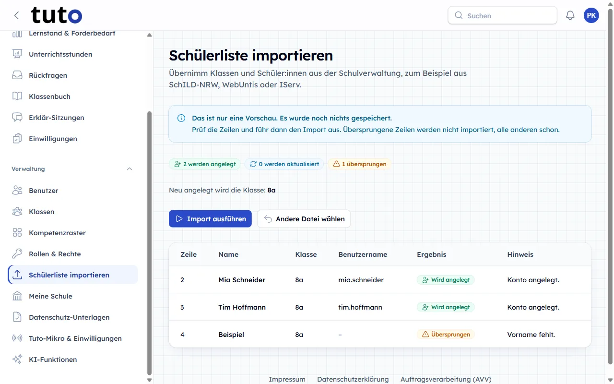<br>
  <sub>Vorschau des Imports</sub>
</p>

**b) Mit dem Klassencode**

1. Zeige der Klasse den Klassencode (Verwaltung → Klassen, Spalte „Klassencode“, oder Unterricht → Unterrichtsstunden → „Klassencodes“).
2. Die Schüler:innen öffnen die Registrierung und legen ihr Konto selbst an ([so geht’s](#registrieren-mit-klassencode)).
3. Ist ein Code in die falschen Hände geraten: Klasse öffnen → „Neuen Code erzeugen“ (oben rechts). Der alte Code funktioniert dann nicht mehr, wer sich schon registriert hat, bleibt in der Klasse.

**c) Von Hand:** Verwaltung → Benutzer, Rolle „Schüler:in“ mit Klasse, oder Verwaltung → Klassen → Klasse öffnen → „Schüler:innen“ → „Schüler:innen hinzufügen“. Mit „Aus Klasse entfernen“ löst du die Zuordnung.

#### Vertretung eintragen (Schuladministration)

**So erreichst du es:** Verwaltung → Klassen → Klasse öffnen → Bereich „Vertretungen“

Die Klassenleitung richtet eine Vertretung auch selbst ein ([so geht’s](#vertretung-einrichten-und-übergabe-mappe)). Du kannst es für jede Klasse deiner Schule.

1. Klicke im Bereich „Vertretungen“ auf **„Vertretung einrichten“** und wähle bei „Wer vertritt?“ eine Lehrkraft der Schule (die Klassenleitung und bereits zugeordnete Lehrkräfte unterrichten die Klasse ohnehin).
2. Lege „Erster Tag“ und „Letzter Tag“ fest (dann „Einrichten“). Eine Vertretung kann nicht in der Vergangenheit beginnen und dauert höchstens 90 Tage. Dieselbe Lehrkraft vertritt eine Klasse zusammengerechnet höchstens so lange. Für länger ordnest du die Lehrkraft der Klasse fest zu.
3. Schreibe bei „Hinweis zur Übergabe“, was die Vertretung wissen soll (Stand im Stoff, Absprachen). Bitte keine Namen oder persönlichen Angaben zu einzelnen Schüler:innen.
4. Im Zeitraum kann die Vertretung Stunden in der Klasse anlegen, die Lernstände sehen, das Klassenbuch lesen und exportieren, Einwilligungen der Eltern erfassen und Tuto-Mikro nutzen. Danach endet das von selbst. Mit „Vorzeitig beenden“ (bzw. „Zurückziehen“ bei einer geplanten) beendest du sie früher.
5. Über „Übergabe-Mappe“ öffnest du die druckbare Mappe der Klasse.

#### Tuto-Mikro für die Schule freischalten

**So erreichst du es:** Seitenleiste → Verwaltung → Tuto-Mikro & Einwilligungen (`/tuto-mikro-einstellungen`)

Das Tuto-Mikro erfasst den Ton von Kindern im Unterricht. Es bleibt aus, bis die Schule die Voraussetzungen bestätigt und einen Einwilligungstext veröffentlicht hat. Die Seite führt dich in drei Schritten.

**Schritt 1: Voraussetzungen.** Hake die fünf Punkte ab, wenn sie für deine Schule gelten, und klicke auf „Speichern“:

- Datenschutz-Folgenabschätzung durchgeführt
- Personalrat beteiligt
- Eltern vorab informiert
- Einwilligungserklärung geprüft und freigegeben
- Aufbewahrungsfrist festgelegt

Darunter stellst du zwei Dinge ein:

- **„Schüler:innen bestätigen zusätzlich selbst“:** Wenn die Eltern allein nicht reichen (je nach Bundesland und Schule), bestätigt jede Schüler:in unter „Tuto-Mikro im Unterricht“ selbst ihr Einverständnis. Erst dann geht das Mikro in ihrer Klasse an.
- **„Fächer ohne Tuto-Mikro“:** In diesen Fächern lässt sich das Mikro nie einschalten, auch nicht mit Einwilligung. Ab Werk sind es Religion, Ethik, Philosophie, Sexualkunde, Sexualerziehung, Werte und Normen und LER, weil es dort oft um Glauben und Persönliches geht. Gesperrt ist eine Stunde, wenn ein Wort ihres Fachs so beginnt („Religion“ sperrt auch „Katholische Religion“). Eigene Fächer schreibst du ein und bestätigst mit Enter. Förderaufgaben haben nie ein Tuto-Mikro.

**Schritt 2: Einwilligungserklärung.** Das ist der Text, den die Eltern bestätigen. Passe Überschrift und Text an (Markdown, die Vorlage ist ein Entwurf und keine Rechtsberatung) und wähle die Zwecke, denen die Eltern einzeln zustimmen: Ton des Unterrichts (immer dabei), Notizen aus der Stunde und Spracherkennung und Zusammenfassung durch den KI-Anbieter. Klicke auf „Als Version 1 veröffentlichen“. Eine veröffentlichte Fassung wird nie geändert: Jede Änderung ist eine neue Fassung, danach gelten alle bisherigen Einwilligungen als veraltet, die Eltern stimmen neu zu, und du bestätigst unter „Voraussetzungen“ erneut, dass der Text geprüft ist.

**Schritt 3: Tuto-Mikro freischalten.** Klicke auf „Tuto-Mikro freischalten“ und bestätige mit „Ja, freischalten“. Der Knopf ist erst aktiv, wenn alle Punkte bestätigt sind und eine Fassung veröffentlicht ist; die Seite nennt, was noch fehlt. Mit „Tuto-Mikro ausschalten“ ist es sofort wieder aus.

Die Seite zeigt außerdem, wie viele Schüler:innen schon eingewilligt haben, und listet alle veröffentlichten Fassungen.

<p align="center">
  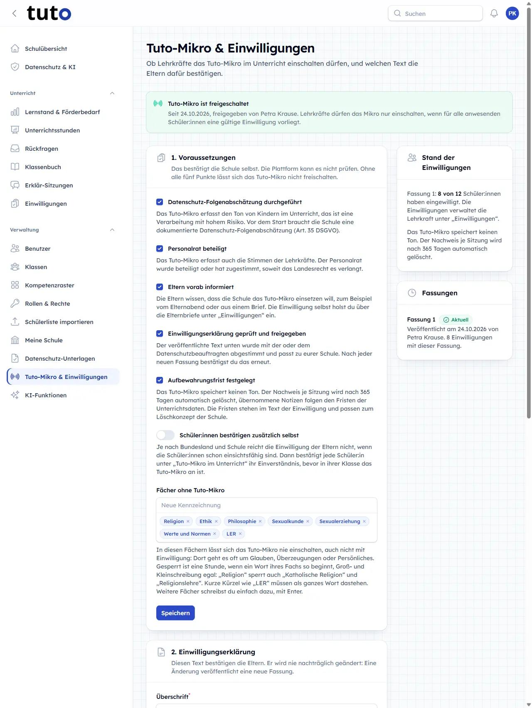<br>
  <sub>Tuto-Mikro &amp; Einwilligungen</sub>
</p>

#### Einwilligungen einsammeln

**So erreichst du es:** Seitenleiste → Unterricht → Einwilligungen (`/einwilligungen`)

Das machen die Lehrkräfte für ihre Klassen, du für alle Klassen der Schule. Die genaue Anleitung steht bei der [Lehrkraft](#einwilligungen-der-eltern-einsammeln).

#### Klassenbuch einsehen und Einträge wieder öffnen

**So erreichst du es:** Seitenleiste → Unterricht → Klassenbuch (`/klassenbuch`)

Du siehst das Klassenbuch jeder Klasse deiner Schule (Klasse oben auswählen) und kannst es als CSV exportieren. Du kannst auch selbst Entwürfe aus jeder Stunde der Schule erstellen und Einträge bearbeiten und bestätigen. Bestätigte Einträge sind gesperrt. Nur du kannst sie mit „Wieder öffnen“ in den Entwurf zurückholen, die Lehrkraft ändert und bestätigt sie dann neu. Das Führen des Klassenbuchs ist unter [Lehrkraft](#klassenbuch-führen) beschrieben.

#### Datenschutz-Unterlagen für die Schule

**So erreichst du es:** Seitenleiste → Verwaltung → Datenschutz-Unterlagen (`/datenschutz-unterlagen`)

Fünf Vorlagen zum Ausdrucken und Anpassen, vorausgefüllt mit den Stammdaten deiner Schule und den echten Einstellungen der Plattform (Aufbewahrung, KI-Anbieter, Schalter deiner Schule, Tuto-Mikro): **Checkliste** (was vor dem Start, vor den KI-Funktionen und vor dem Tuto-Mikro zu klären ist), **Folgenabschätzung** (Art. 35 DSGVO), **Verzeichnis** der Verarbeitungstätigkeiten (Art. 30), **Elterninformation** (Art. 13) und **Einwilligung** (Muster für das Tuto-Mikro). Die Vorlagen sind Entwürfe und keine Rechtsberatung: Stimme sie mit deiner Datenschutzbeauftragten oder deinem Datenschutzbeauftragten ab.

<p align="center">
  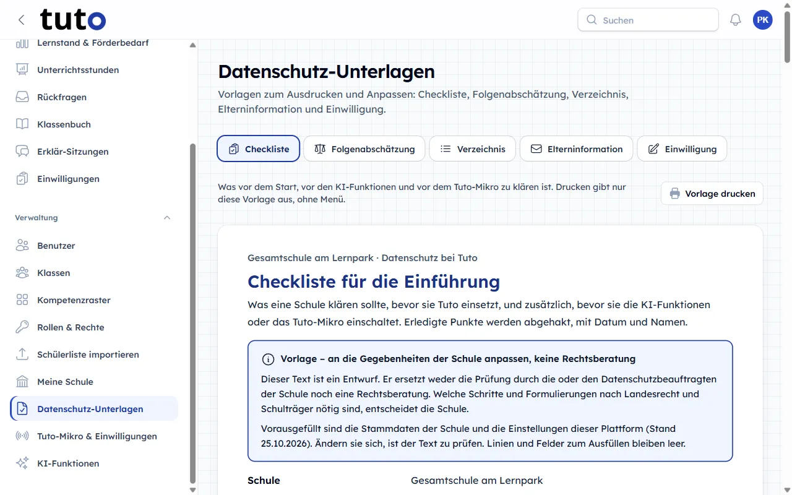<br>
  <sub>Datenschutz-Unterlagen</sub>
</p>

#### Auswertungen deiner Schule

Du siehst alle Stunden, Abgaben und Ergebnisse deiner Schule (Unterricht → Unterrichtsstunden, Lernstand & Förderbedarf, Erklär-Sitzungen, Rückfragen). Die Anleitung dazu steht bei der [Lehrkraft](#44-lehrkraft). Du kannst Stunden anlegen und freigeben wie eine Lehrkraft. Das Tuto-Mikro in der Stunde einschalten kann nur die Lehrkraft der Stunde.

---

### 4.4 Lehrkraft

Anmelden mit `lehrer` (Demo). Deine Klassen siehst du erst, wenn die Schuladministration dich als Klassenleitung eingetragen oder einer Klasse zugeordnet hat.

Der Alltag in vier Schritten: **Stunde erfassen → Hausaufgabe mit KI erstellen → prüfen → freigeben.** Auf der Seite **Heute** geht das in 30 Sekunden.

#### Heute: Hausaufgaben prüfen und freigeben

**So erreichst du es:** Seitenleiste → Unterricht → Heute (`/heute`)

Die Seite zeigt deine Stunden von heute und den letzten beiden Schultagen (Montag bis Freitag). Förderaufgaben stehen hier nicht.

1. Die Tabelle zeigt je Stunde Thema, Fach und Klasse, den Status („Wartet auf Freigabe“ oder „Freigegeben“), die Hausaufgabe („Noch kein Entwurf“ oder „5 Fragen“) und wie viele schon abgegeben haben.
2. Klicke in der Zeile auf „Hausaufgabe mit KI erstellen“. Danach siehst du „5 Fragen“. (Gibt es schon einen Entwurf, fragt Tuto vorher, ob er ersetzt werden soll.)
3. Klicke auf die Zeile, um Zusammenfassung und Fragen zu prüfen und anzupassen ([so geht’s](#hausaufgabe-mit-ki-erstellen-prüfen-und-freigeben)).
4. Klicke in der Zeile auf „Freigeben“, wähle „Abgabe bis“ (Vorgabe: in sieben Tagen) und bestätige mit „Freigeben“. Die Hausaufgabe geht an die ganze Klasse.
5. Haben mehrere Stunden Fragen und warten auf die Freigabe, gibt „Alle bereiten freigeben“ oben rechts alle auf einmal frei.

Die Schüler:innen bekommen eine Meldung in der Glocke.

<p align="center">
  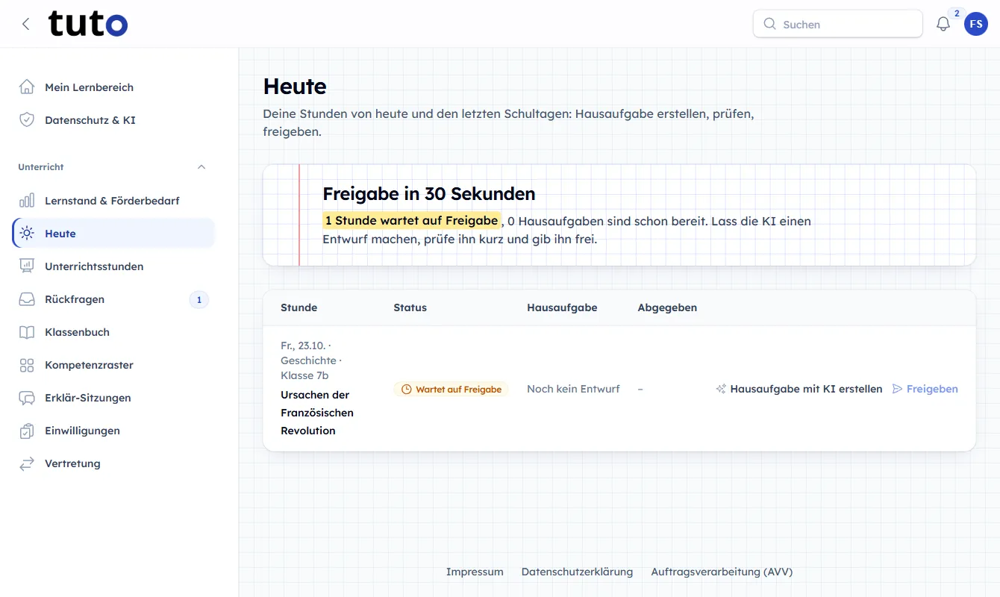<br>
  <sub>Heute: Hausaufgaben prüfen und freigeben</sub>
</p>

#### Stunde erfassen

**So erreichst du es:** Seitenleiste → Unterricht → Unterrichtsstunden (`/lessons`) → oben rechts „Stunde erfassen“, oder auf der Startseite „Neue Unterrichtsstunde“

1. Wähle die **Klasse** (du siehst nur Klassen, die du unterrichtest), „Gehalten am“, **Fach** und **Thema**. Für das Fach schlägt Tuto Fächer des Kompetenzrasters vor, damit die Zuordnung zu Kompetenzen klappt.
2. Schreibe unter „Inhalt der Stunde“ deine **Notizen**: Stichpunkte, Tafelbild, Ablauf. Daraus entsteht der Entwurf. Je konkreter ein Moment der Stunde beschrieben ist (ein Versuch, eine Diskussion, ein Beispiel), desto besser wird die Reflexionsfrage. Bitte keine personenbezogenen Daten eintragen.
3. Lade bei Bedarf **Arbeitsblätter** als Foto oder Scan hoch (JPG, PNG, WebP, HEIC oder PDF, bis 10 MB je Datei). Auf Arbeitsblättern sollten keine Namen stehen.
4. Hast du in dieser Klasse und diesem Fach schon eine Stunde ausgewertet, zeigt Tuto oben, was die Klasse beim letzten Mal noch nicht sicher verstanden hat, mit dem Link „Einstieg der letzten Stunde öffnen“.
5. Klicke auf „Erstellen“.

Die Liste der Stunden zeigt Datum, Klasse, Fach, Thema, Status, wie viele abgegeben haben und das durchschnittliche Verständnis. Mit den Filtern grenzt du nach Klasse, Status und Art (normale Stunde oder Förderaufgabe) ein.

<p align="center">
  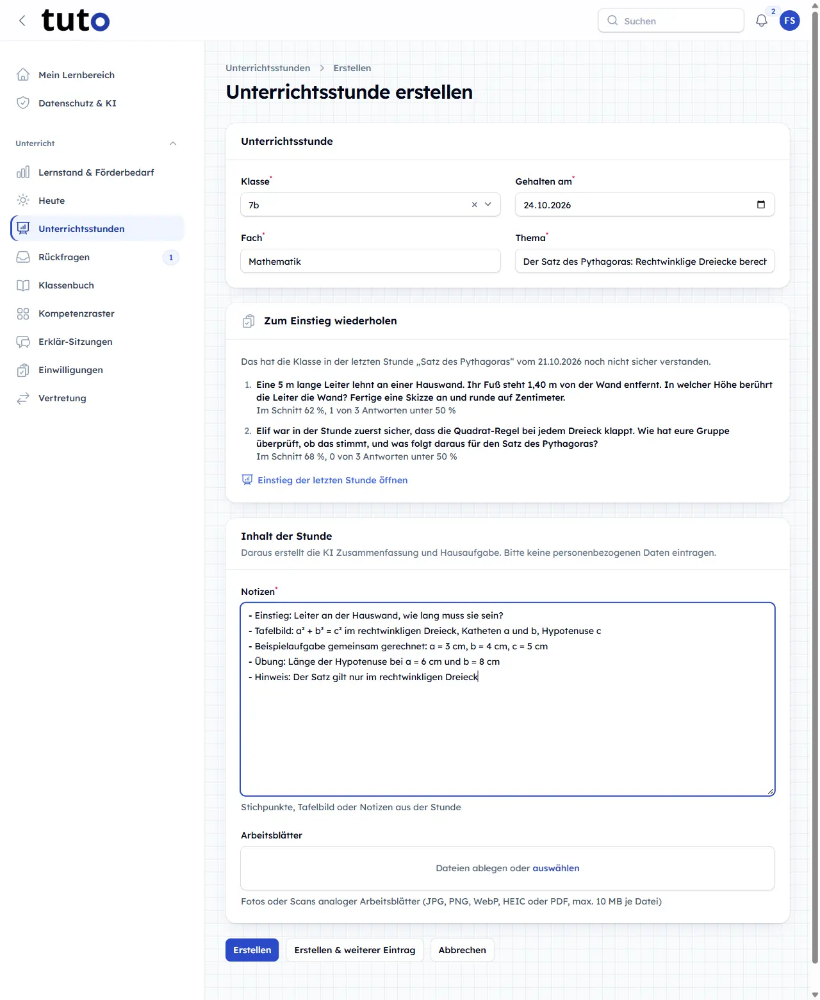<br>
  <sub>Stunde erfassen</sub>
</p>

#### Tuto-Mikro: Notizen aus der Stunde

**So erreichst du es:** Unterricht → Unterrichtsstunden → Stunde öffnen → „Tuto-Mikro“ (oben rechts). Die Seite öffnet sich unter `/tuto-mikro/{Stunde}`.

Das Tuto-Mikro ist **dein Mikrofon**: Trage ein Ansteckmikrofon oder ein Headset dicht am Mund. Der Browser kann Stimmen nicht trennen, was in deiner Nähe laut gesagt wird, kann mitgeschrieben werden. Es gibt nur Ton, nie Bild. Der Ton wird nicht gespeichert.

Der Knopf „Tuto-Mikro“ fehlt bei Förderaufgaben und in Fächern, die deine Schule vom Tuto-Mikro ausgenommen hat. Ist das Mikro für deine Schule nicht freigeschaltet, zeigt der Knopf einen Hinweis ([so schaltet die Schuladministration es frei](#tuto-mikro-für-die-schule-freischalten)). Nur die Lehrkraft der Stunde kommt auf die Seite, auch die Schuladministration nicht.

**Einwilligungs-Prüfung:**

1. Unter **„Wer ist heute da?“** sind alle Schüler:innen der Klasse angehakt. Hake ab, wer fehlt („Alle“ und „Niemand“ helfen dabei). Mit „Namen verbergen“ blendest du die Namen aus, wenn jemand mitschaut.
2. Tuto prüft sofort, ob für **alle**, die angehakt sind, eine gültige Einwilligung vorliegt. Die Seite zeigt je Schüler:in den Stand: „Erteilt“, „Teilweise“, „Fehlt“, „Widerrufen“, „Veraltet“ oder „Schüler:in-Bestätigung fehlt“. Solange das nicht für alle „Erteilt“ ist, bleibt „Mikro an“ gesperrt. Die Einwilligungen holst du unter Unterricht → Einwilligungen ein ([so geht’s](#einwilligungen-der-eltern-einsammeln)).
3. Setze den Haken **„Ich bestätige: Nur die Schüler:innen, die hier angehakt sind, sind im Raum.“** Ändert sich die Liste, nimmt Tuto die Bestätigung zurück.
4. Klicke auf **„Mikro an“**. Dein Browser fragt, ob er das Mikrofon benutzen darf. Erlaube es. Tuto-Mikro funktioniert nur über eine gesicherte Verbindung (https). Ist das Mikrofon blockiert, steht auf der Seite, wie du es freigibst.
5. Bis zum Ende bleibt die Seite offen. Kommt jemand dazu, schalte das Mikro aus, hake die Person an und schalte es wieder an. Mit **„Mikro aus“** beendest du die Sitzung.

<p align="center">
  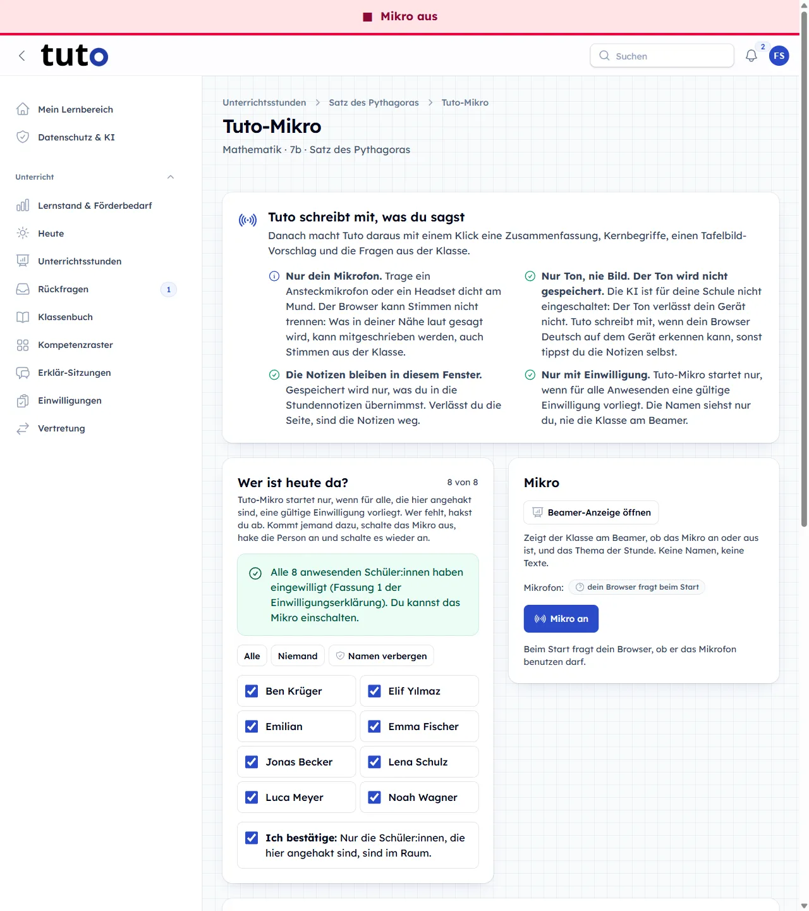<br>
  <sub>Tuto-Mikro: Wer ist heute da? und Einwilligungs-Prüfung</sub>
</p>

**Beamer-Anzeige:** Klicke auf „Beamer-Anzeige öffnen“, ziehe das neue Fenster auf den Beamer und klicke dort auf „Vollbild“. Die Klasse sieht, ob das Mikro **an** oder **aus** ist, und das Thema der Stunde, sonst nichts: keine Namen, keine Texte. „Mikro aus“ ist als Einziges rot.

<p align="center">
  <br>
  <sub>Beamer-Anzeige</sub>
</p>

**Nach der Stunde:**

1. Unter **„Notizen aus der Stunde“** steht, was Tuto mitgeschrieben hat. Ist die KI deiner Schule an, geht der Ton in kurzen Abschnitten (etwa 25 Sekunden) zur Spracherkennung. Dafür müssen die Eltern aller Anwesenden auch dem Zweck „Spracherkennung und Zusammenfassung durch den KI-Anbieter“ zugestimmt haben, sonst bleibt „Mikro an“ gesperrt. Ist die KI aus, schreibt Tuto nur mit, wenn dein Browser Deutsch auf dem Gerät erkennen kann, und der Ton verlässt dein Gerät nicht. Du kannst die Notizen auch selbst tippen oder einfügen. Lies sie durch und korrigiere Erkennungsfehler.
2. Klicke auf **„Zusammenfassung erstellen“**. Tuto macht daraus: Zusammenfassung, Kernbegriffe, Tafelbild-Vorschlag und Fragen aus der Klasse. Zur KI geht dabei nur der Text, nie der Ton, und die Namen deiner Klasse und dein eigener werden vorher durch Platzhalter ersetzt. Ist die KI für deine Schule aus, entsteht die Zusammenfassung auf der Plattform.
3. Prüfe die Ergebnisse. Gespeichert wird nur, was du übernimmst: **„In Stundennotizen übernehmen“** hängt das Ergebnis an die Notizen der Stunde an (Namen der Klasse werden dabei ersetzt), **„Hausaufgabe daraus erstellen“** übernimmt es und führt dich zur Stunde, wo du die Hausaufgabe erstellst. Das geht nur für eine Stunde, die noch nicht freigegeben ist.
4. **„Notizen verwerfen“** löscht den Text. Verlässt du die Seite, sind die Notizen weg.

Ganz unten unter „Tuto-Mikro in dieser Stunde“ siehst du den Nachweis je Sitzung: wann das Mikro an war, wie lange und wie viele Schüler:innen du als anwesend markiert hattest. Es gibt keinen Ton und keinen Text, und die Einträge werden nach 365 Tagen gelöscht.

#### Hausaufgabe mit KI erstellen, prüfen und freigeben

**So erreichst du es:** Unterricht → Unterrichtsstunden → Stunde öffnen (oder auf **Heute** in der Zeile klicken)

1. Klicke oben rechts auf **„Hausaufgabe mit KI erstellen“**. Tuto liest deine Notizen (und Arbeitsblätter) und erstellt eine **Zusammenfassung** der Stunde und fünf **Fragen**: zwei Verständnis-, zwei Anwendungs- und eine Reflexionsfrage. Zu jeder Frage gehört ein **Erwartungshorizont**, den nur du siehst. Zeigt Tuto die Meldung „Demo-Modus“, läuft die KI nicht und die Fragen sind Beispielentwürfe: Entweder ist der Plattformschalter aus oder deine Schule hat die KI noch nicht freigeschaltet (siehe [die zwei Schalter](#ki-einschalten-zwei-schalter)).
2. **Prüfe die Zusammenfassung.** Sie steht unter „Zusammenfassung“ und lässt sich direkt ändern. Die Schüler:innen lesen sie vor den Fragen. Speichere deine Änderungen.
3. **Prüfe die Fragen** im Bereich **„Hausaufgabe“**. Du kannst jede Frage mit „Bearbeiten“ ändern (Art, Kompetenz, Frage, Erwartungshorizont), mit „Löschen“ entfernen, per Ziehen umordnen und über „Erstellen“ eigene Fragen ergänzen. Die Kompetenz ordnet die Frage dem Kompetenzraster zu, daraus wird später der Lernstand.
4. **Stufen (optional):** Mit „Stufen mit KI erstellen“ (über der Tabelle für alle Fragen, in der Zeile für eine Frage) ergänzt die KI zu jeder Frage die Stufen „Einstieg“ und „Profi“. Selbst geschriebene Stufen bleiben erhalten. Du kannst die Stufen auch im Formular der Frage selbst schreiben („Stufe Einstieg (optional)“, „Stufe Profi (optional)“). Der Erwartungshorizont bleibt für alle Stufen gleich.
5. Klicke oben rechts auf **„Freigeben“** (der Knopf ist erst aktiv, wenn es Fragen gibt). Wähle „Abgabe bis“ und bei „Für wen?“ entweder „Ganze Klasse …“ oder „Ausgewählte Schüler:innen“ (dann wählst du die Namen). Bestätige mit „Freigeben“. Die Schüler:innen finden die Fragen danach in ihrem Lernbereich und bekommen eine Meldung. Den Erwartungshorizont sehen sie nicht.

Nach der Freigabe sind die Fragen gesperrt, weil die Schüler:innen schon antworten könnten. Mit **„Freigabe zurücknehmen“** holst du die Hausaufgabe zurück, solange noch niemand abgegeben hat.

<p align="center">
  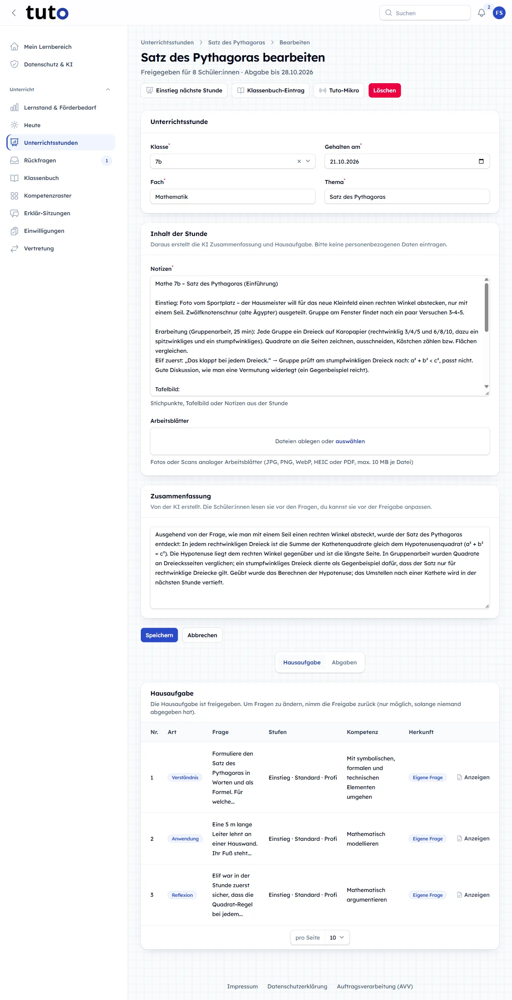<br>
  <sub>Stunde mit Zusammenfassung und Fragen</sub>
</p>

<p align="center">
  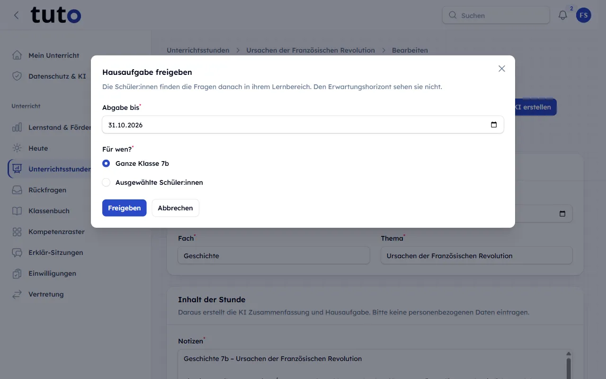<br>
  <sub>Hausaufgabe freigeben</sub>
</p>

**Abgaben ansehen:** Im Bereich **„Abgaben“** derselben Seite siehst du, wer abgegeben hat, mit Zeitpunkt und Verständnis (zum Beispiel „Gut verstanden“, „Teilweise verstanden“, „Förderbedarf“). Über „Ansehen“ liest du Zusammenfassung, Antworten, die KI-Rückmeldung und die Lücken. Die Werte sind eine Einschätzung der KI und keine Note. Mit **„Zur Überarbeitung zurückgeben“** löschst du eine Abgabe samt KI-Prüfung, die Schüler:in kann dann neu abgeben. Über der Tabelle steht, wer noch nicht abgegeben hat.

#### Einwilligungen der Eltern einsammeln

**So erreichst du es:** Seitenleiste → Unterricht → Einwilligungen (`/einwilligungen`)

Voraussetzung: Die Schuladministration hat den Einwilligungstext veröffentlicht ([Schritt 2 hier](#tuto-mikro-für-die-schule-freischalten)). Sonst weist dich die Seite darauf hin.

1. Wähle oben die **Klasse**. Die Tabelle zeigt je Schüler:in den Stand der Einwilligung mit Text und Symbol: „Erteilt“, „Teilweise“, „Fehlt“, „Widerrufen“, „Veraltet“, „Schüler:in-Bestätigung fehlt“.
2. Klicke neben der Klassenauswahl auf **„Elternbriefe erzeugen“**, wähle „Nur für Schüler:innen, die noch keinen Brief hatten“ oder „Für die ganze Klasse neu“ und bestätige mit „Briefe erzeugen“. Du bekommst eine druckbare Seite mit einem Brief je Schüler:in (eine A4-Seite) mit persönlichem Link, QR-Code und Abschnitt für eine Antwort auf Papier. **Die Links siehst du nur jetzt.** Ein neuer Brief macht den alten Link ungültig.
3. Drucke die Briefe und gib sie den Schüler:innen mit.
4. Die Eltern öffnen den Link oder scannen den QR-Code und erteilen die Einwilligung ([so sieht es für die Eltern aus](#46-eltern)). Der Stand in deiner Tabelle ändert sich von selbst.
5. Kommt die Antwort auf Papier zurück: Klicke in der Zeile der Schüler:in auf **„Aktionen“** → **„Papier-Einwilligung erfassen“**, trage den Namen der unterschreibenden Person, die angekreuzten Zwecke (der Ton gehört immer dazu) und das Datum der Unterschrift ein. Das Blatt bewahrt die Schule als Nachweis auf. Die jüngste Erklärung gilt: Ein Blatt, das älter ist als ein späterer Widerruf der Eltern, zählt nicht.
6. Widerrufen die Eltern: **„Aktionen“ → „Widerruf erfassen“**. Danach bleibt das Mikro in jeder Stunde aus, in der diese Schüler:in dabei ist, bis die Eltern neu einwilligen.
7. Ein Brief ist verloren gegangen: **„Aktionen“ → „Neuen Brief erzeugen“** macht für diese Schüler:in einen neuen Brief mit neuem Link. Der alte Link ist dann ungültig.

Verlangt deine Schule zusätzlich die eigene Zustimmung der Schüler:innen, zeigt die Seite „Schüler:in-Bestätigung fehlt“, bis diese unter „Tuto-Mikro im Unterricht“ zugestimmt haben.

<p align="center">
  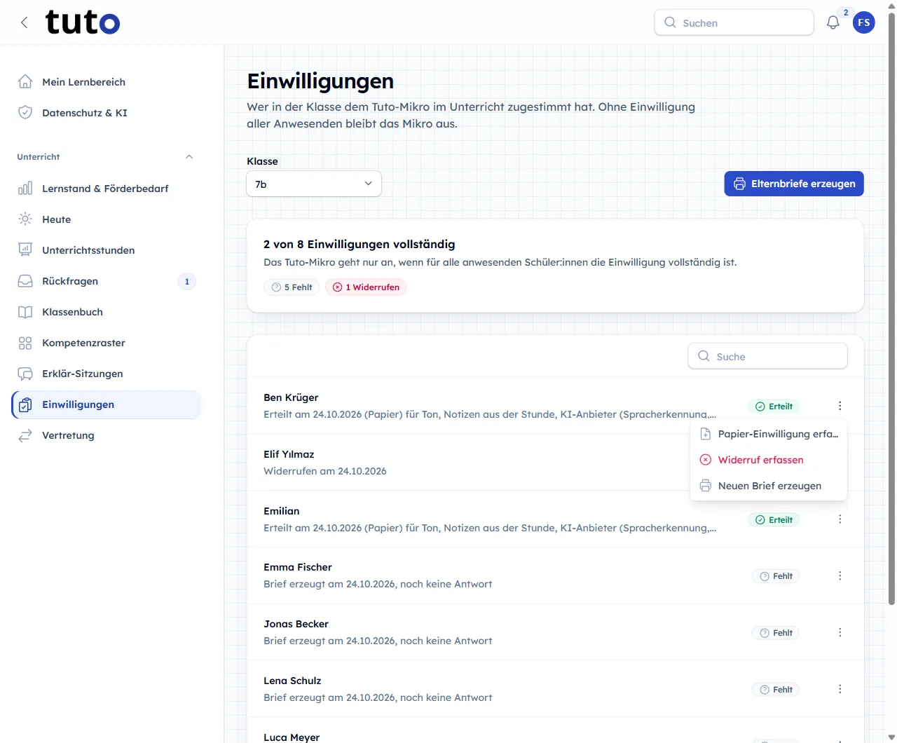<br>
  <sub>Einwilligungen einer Klasse</sub>
</p>

#### Einstieg in die nächste Stunde

**So erreichst du es:** Unterricht → Unterrichtsstunden → Stunde öffnen → „Einstieg nächste Stunde“ (oben rechts), oder auf der Startseite in der Stunden-Liste „Einstieg nächste Stunde“

Eine Tafel für den Beamer mit den **drei Punkten, die die Klasse am wenigsten verstanden hat**, jeweils mit der Frage „Wer kann das erklären?“ und dem durchschnittlichen Ergebnis. Es erscheinen nur Werte der Klasse, nie Namen oder Einzelergebnisse. Dafür braucht es mindestens drei ausgewertete Abgaben.

1. Öffne die Seite am Anfang der nächsten Stunde.
2. „Lösungshinweise einblenden“ zeigt zu jedem Punkt den Hinweis aus deinem Erwartungshorizont, wenn du ihn brauchst. Er bleibt unsichtbar, bis du ihn einblendest.
3. „Vollbild“ füllt den Beamer, „Drucken“ gibt die Tafel als Blatt aus.

<p align="center">
  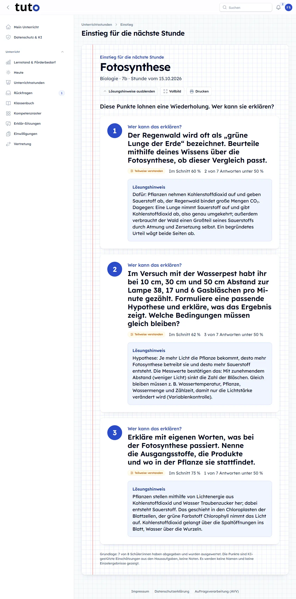<br>
  <sub>Einstieg für die nächste Stunde</sub>
</p>

#### Klassenbuch führen

**So erreichst du es:** Seitenleiste → Unterricht → Klassenbuch (`/klassenbuch`), oder in der Stunde oben rechts „Klassenbuch-Eintrag“

Das Klassenbuch hält fest, was in der Klasse unterrichtet wurde, die Hausaufgabe und wer gefehlt hat. Tuto schreibt den Entwurf vor, du prüfst und bestätigst ihn.

1. Klicke in der Stunde auf **„Klassenbuch-Eintrag“**. Gibt es schon einen Entwurf, öffnet er sich zum Bearbeiten. Sonst erstellt Tuto ihn aus der Stunde. Alternativ wählst du auf der Seite Klassenbuch die Klasse und klickst auf „Entwurf aus Stunde erstellen“.
2. Tuto übernimmt Fach, Thema und Datum, schreibt den Unterrichtsinhalt aus Zusammenfassung oder Notizen vor und trägt freigegebene Hausaufgaben ein. Wer fehlt, kommt aus der bestätigten Anwesenheitsliste des Tuto-Mikros, wenn es eine gibt. Schüler:innen, die nicht angehakt waren, aber noch keine Einwilligung haben, trägt Tuto **nicht** als fehlend ein, das machst du von Hand.
3. Klicke in der Zeile auf **„Bearbeiten“** und ergänze: Datum, „Unterrichtsstunde (1 bis 12)“, Fach, Thema, Unterrichtsinhalt, Hausaufgabe, „Fehlende Schüler:innen“ und Bemerkungen. Speichern.
4. Klicke auf **„Bestätigen“** und bestätige mit „Ja, bestätigen“. Das geht erst, wenn Fach, Thema und Unterrichtsinhalt ausgefüllt sind. Danach ist der Eintrag gesperrt, nur die Schuladministration kann ihn wieder öffnen.
5. **„CSV exportieren“** (oben rechts) gibt Einträge eines Zeitraums als Datei aus, auch mit den Namen der Fehlenden. Gib sie nur an Berechtigte weiter.

Das Klassenbuch sehen die Lehrkräfte der Klasse (auch Vertretungen, solange sie dauert) und die Schuladministration, nie die Schüler:innen, weil die Einträge Fehlende nennen. Bearbeiten und bestätigen kannst du nur die Einträge deiner eigenen Stunden. Die Einträge anderer Lehrkräfte der Klasse liest und exportierst du nur, die Schuladministration kann sie bearbeiten und bestätigen.

<p align="center">
  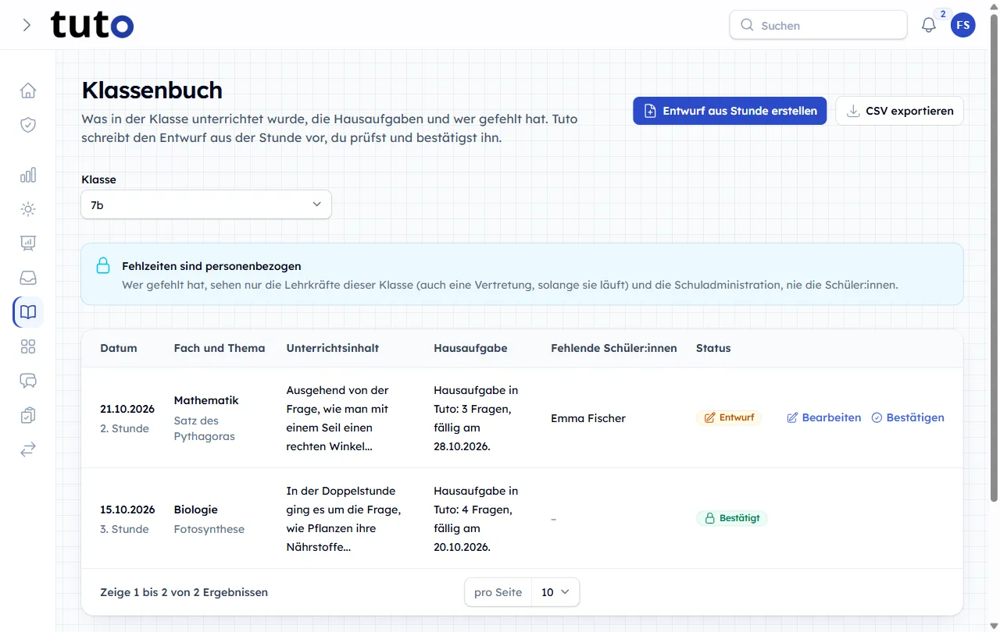<br>
  <sub>Klassenbuch</sub>
</p>

#### Rückfragen der Schüler:innen beantworten

**So erreichst du es:** Seitenleiste → Unterricht → Rückfragen (`/rueckfragen`). Eine Zahl am Menüpunkt zeigt die offenen Fragen.

Schüler:innen stellen Fragen zu deinen Stunden, aus ihrem Hausaufgaben-Ergebnis und aus Erklär’s mir. Auf die Fragen kommst du auch über die Glocke („Neue Frage zu …“).

1. Die Tabelle zeigt Frage, Stunde, Antwort und Status („Offen“, „Beantwortet“, „Erledigt“).
2. Klicke in der Zeile auf **„Beantworten“**, schreibe unter „Deine Antwort“ und klicke auf „Antwort schicken“. Die Schüler:in erfährt es per Glocke und liest die Antwort unter „Meine Rückfragen“.
3. Hast du die Frage schon im Unterricht besprochen, klicke auf **„Erledigt“** (mehrere auf einmal: „Als erledigt markieren“). Die Schüler:in sieht, dass du die Frage als erledigt markiert hast.

Die Fragen lesen nur du und die Schuladministration, die Mitschüler:innen nicht.

<p align="center">
  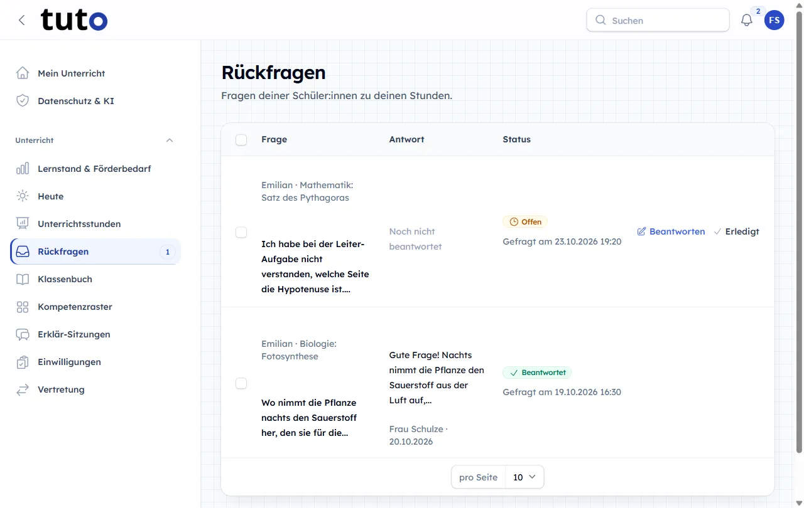<br>
  <sub>Rückfragen der Schüler:innen</sub>
</p>

#### Lernstand und Förderbedarf

**So erreichst du es:** Seitenleiste → Unterricht → Lernstand & Förderbedarf (`/lernstand`), oder auf der Startseite „Lernstand & Förderbedarf“

1. Wähle oben die **Klasse**.
2. Die **Kompetenzmatrix** zeigt je Schüler:in und Kompetenz den Durchschnitt aller von der KI bewerteten Antworten (0 bis 100). Ein Strich heißt: noch keine bewertete Antwort. Unter 50 Punkten gilt „Förderbedarf“, ab 75 „Gut verstanden“.
3. Der Bereich **„Förderbedarf“** listet die Schüler:innen mit mindestens einer Kompetenz unter 50 Punkten, mit den Stunden, in denen sich die Lücke gezeigt hat.
4. **„Klassendurchschnitt je Stunde“** zeigt, wie die Klasse bei jeder Hausaufgabe im Schnitt abgeschnitten hat.

Der Wert ist eine Einschätzung der KI. Er zeigt, wo jemand Unterstützung braucht, ersetzt aber keine Beurteilung. Die Kennzahlen auf der Startseite („Abgaben offener Hausaufgaben“, „Ø Verständnis der letzten Hausaufgabe“, „Schüler:innen mit Förderbedarf“) kommen aus denselben Daten.

<p align="center">
  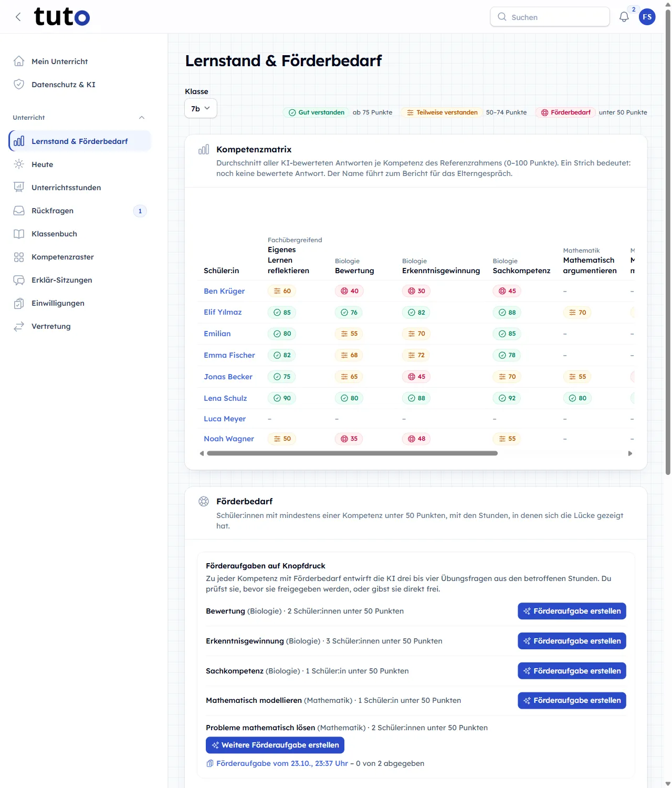<br>
  <sub>Lernstand und Förderbedarf</sub>
</p>

#### Förderaufgabe erstellen

**So erreichst du es:** Unterricht → Lernstand & Förderbedarf → im Bereich „Förderbedarf“ bei einer Kompetenz „Förderaufgabe erstellen“

1. Klicke bei der Kompetenz auf „Förderaufgabe erstellen“ (gibt es schon eine, heißt der Knopf „Weitere Förderaufgabe erstellen“).
2. Vorausgewählt sind alle Schüler:innen, die in dieser Kompetenz unter der Förderschwelle liegen und noch keine offene Förderaufgabe dazu haben. Passe die Auswahl an.
3. Entscheide mit dem Schalter **„Direkt freigeben“**: Aus (Vorgabe) heißt, du prüfst die Förderaufgabe zuerst als Entwurf und gibst sie danach selbst frei. An heißt, die ausgewählten Schüler:innen sehen sie sofort. Dann wählst du „Abgabe bis“.
4. Klicke auf „Förderaufgabe erstellen“. Die KI entwirft aus den Stunden, in denen sich die Lücke gezeigt hat, drei bis vier Übungsfragen von leicht bis schwer. Sie bekommt Fach, Kompetenz, Stundennotizen und anonyme Hinweise, keine Namen.
5. Ein Entwurf öffnet sich als Stunde mit dem Abzeichen „Förderaufgabe“. Prüfe sie und gib sie mit **„Freigeben“** an die vorausgewählten Schüler:innen frei (bei „Für wen?“ ist „Ausgewählte Schüler:innen“ voreingestellt).

Schüler:innen bearbeiten eine Förderaufgabe wie eine Hausaufgabe, mit kürzerer eigener Zusammenfassung (mindestens 40 Zeichen). Eine Förderaufgabe hat kein Tuto-Mikro, keinen Einstieg und keinen Klassenbuch-Eintrag.

<p align="center">
  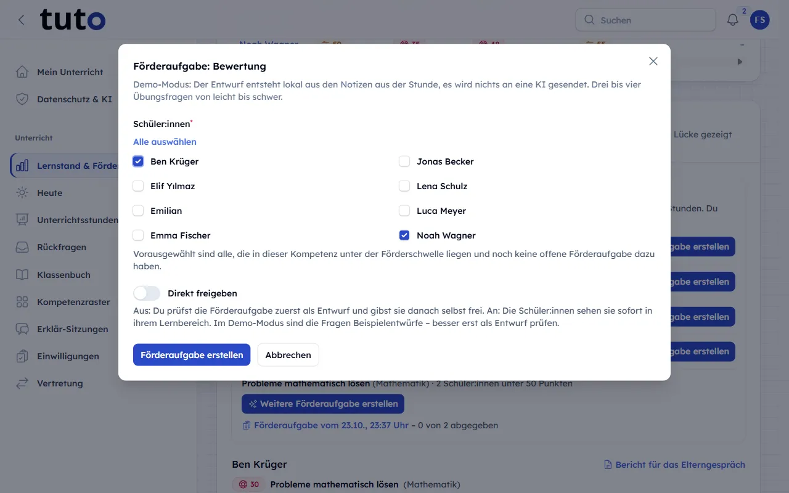<br>
  <sub>Förderaufgabe erstellen</sub>
</p>

#### Bericht für das Elterngespräch

**So erreichst du es:** Unterricht → Lernstand & Förderbedarf → Namen einer Schüler:in anklicken (oder „Bericht für das Elterngespräch“ im Bereich „Förderbedarf“)

Eine druckbare Seite („Elterngespräch: Name“) mit Durchschnitt aller bewerteten Hausaufgaben, Abgabequote (pünktlich, verspätet, nicht abgegeben), Verlauf, Stärken, Förderbedarf je Kompetenz, allen Hausaufgaben mit Rückmeldung und Lücken und den Erklär’s-mir-Sitzungen. Oben rechts druckst du sie mit „Drucken“. Die Punktwerte sind KI-gestützte Einschätzungen, keine Noten.

<p align="center">
  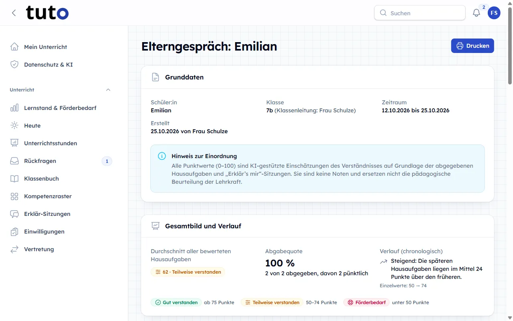<br>
  <sub>Bericht für das Elterngespräch</sub>
</p>

#### Vertretung einrichten und Übergabe-Mappe

**So erreichst du es:** Seitenleiste → Unterricht → Vertretung (`/vertretung`)

Als Klassenleitung gibst du deine Klasse für einige Tage oder Wochen an eine Kollegin oder einen Kollegen.

1. Klicke oben rechts auf **„Vertretung einrichten“**.
2. Wähle die Klasse (hast du nur eine, ist sie voreingestellt), bei „Wer vertritt?“ die Lehrkraft, „Erster Tag“ und „Letzter Tag“ und schreibe einen **Hinweis zur Übergabe**: Stand im Stoff, Absprachen, Besonderheiten der Klasse. Bitte keine Namen oder persönlichen Angaben zu einzelnen Schüler:innen.
3. Klicke auf „Einrichten“. Im Zeitraum kann die Vertretung in der Klasse Stunden anlegen, die Lernstände sehen, das Klassenbuch lesen und exportieren, Einwilligungen der Eltern erfassen und Tuto-Mikro nutzen. Danach endet das von selbst. Eine Vertretung dauert höchstens 90 Tage (zusammengerechnet für dieselbe Lehrkraft und Klasse).
4. Die Liste zeigt Vertretungen deiner Klassen und Klassen, die du vertrittst: Zeitraum, Status (laufend, geplant, beendet) und Hinweis. Mit „Vorzeitig beenden“ bzw. „Zurückziehen“ beendest du eine früher.
5. **„Übergabe-Mappe“** (oben rechts, bei mehreren Klassen ein Auswahlmenü) öffnet eine druckbare Mappe: die letzten Stunden mit Zusammenfassung, offene Hausaufgaben mit Abgabestand, was die Klasse am Anfang der nächsten Stunde wiederholen sollte, der Hinweis zur Übergabe und die Klassenleitung als Ansprechperson. Es stehen nur Werte der Klasse darin, keine Namen und keine Einzelergebnisse. Du kannst sie schon vor einer Vertretung ausdrucken.

Wer eine Klasse vertritt, findet sie im Zeitraum in allen Klassenauswahlen und öffnet die Übergabe-Mappe auf der Seite Vertretung über „Übergabe-Mappe“ in der Zeile der Vertretung.

<p align="center">
  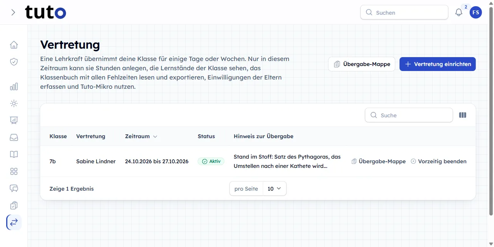<br>
  <sub>Vertretung</sub>
</p>

<p align="center">
  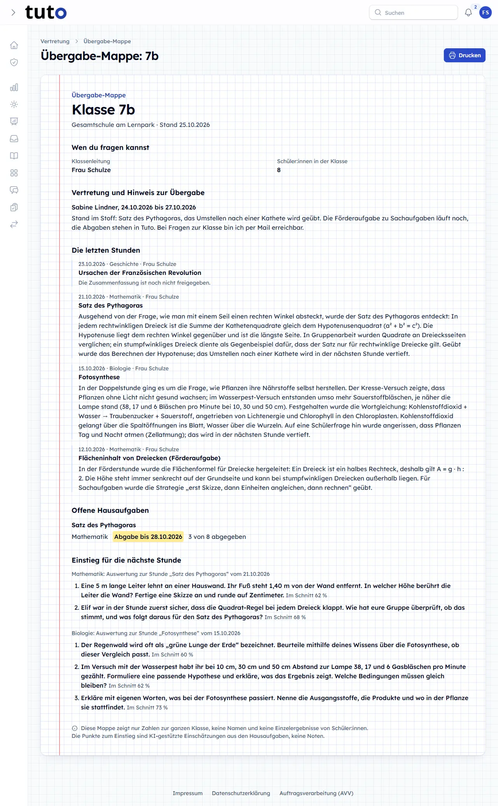<br>
  <sub>Übergabe-Mappe</sub>
</p>

#### Klassencode zeigen

**So erreichst du es:** Unterricht → Unterrichtsstunden → oben rechts „Klassencodes“

Das Fenster zeigt für jede deiner Klassen den Klassencode und die Adresse der Registrierung. Schreibe den Code für die Registrierung an die Tafel.

#### Erklär-Sitzungen und Kompetenzraster nachschlagen

- **Erklär-Sitzungen** (Unterricht → Erklär-Sitzungen): Nur lesen. Du siehst, wie Schüler:innen Themen deiner Stunden erklären, mit Verlauf und Auswertung. Freie Themen der Schüler:innen bleiben bei ihnen.
- **Kompetenzraster** (Unterricht → Kompetenzraster): Nachschlagen, welche Kompetenzen es gibt.

---

### 4.5 Schüler:in

Anmelden mit `schueler` (Demo, Emilian).

<p align="center">
  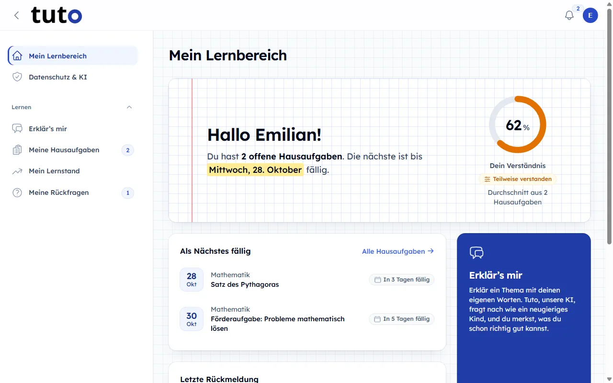<br>
  <sub>Startseite einer Schüler:in</sub>
</p>

#### Registrieren mit Klassencode

**So erreichst du es:** `/register`, oder auf der Anmeldeseite „Mit Klassencode registrieren“

1. Gib deinen Namen, einen Benutzernamen und den **Klassencode** ein, den deine Lehrkraft zeigt (Groß- und Kleinschreibung, Leerzeichen und Striche sind egal). Der Benutzername hat 3 bis 30 Zeichen: Kleinbuchstaben, Zahlen, Punkt, Minus und Unterstrich.
2. Wähle ein Passwort mit mindestens 8 Zeichen und wiederhole es. Eine E-Mail-Adresse ist freiwillig, damit kannst du dein Passwort selbst zurücksetzen.
3. Klicke auf „Konto erstellen“. Du bist danach angemeldet und in deiner Klasse.

Wurde dein Konto von der Schule angelegt (Import), bekommst du Benutzername und Startpasswort von deiner Lehrkraft. Ändere das Passwort danach im Profil.

<p align="center">
  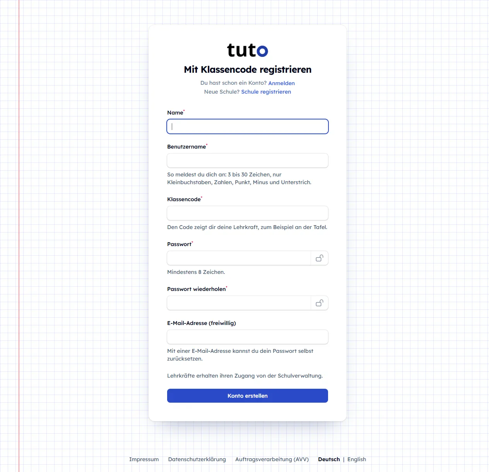<br>
  <sub>Registrieren mit Klassencode</sub>
</p>

#### Mein Lernbereich

Die Startseite begrüßt dich mit „Hallo …!“ und zeigt, was offen ist, wie gut du die Themen bisher verstanden hast („Dein Verständnis“), „Als Nächstes fällig“ und einen Einstieg in Erklär’s mir. Neue Hausaufgaben meldet außerdem die Glocke.

#### Hausaufgabe bearbeiten

**So erreichst du es:** Seitenleiste → Lernen → Meine Hausaufgaben (`/hausaufgaben`) → Zeile anklicken. Eine Zahl am Menüpunkt zeigt, wie viele noch offen sind.

Die Liste zeigt Thema, Fach, Stunde vom, Status („Offen“, „Überfällig“, „Abgegeben“) und Abgabedatum.

1. **Lies zuerst die Zusammenfassung deiner Lehrkraft** oben auf der Seite. Sie ist das Material für deine Antworten.
2. **Beantworte die Fragen.** Jede Frage hat eine Art (Verständnis, Anwendung oder Reflexion) und, wenn deine Lehrkraft Stufen vorbereitet hat, eine Auswahl der Stufe ([siehe unten](#stufe-wählen-und-einfache-sprache)).
3. **Schreibe ganz unten in „In deinen Worten“ deine eigene Zusammenfassung:** Was war wichtig in der Stunde? Schreib es so, dass es jemand versteht, der nicht dabei war. Mindestens 80 Zeichen, ein paar ganze Sätze reichen. Nicht abschreiben: Ein längerer Text, der zu etwa 70 Prozent oder mehr wörtlich aus der Zusammenfassung deiner Lehrkraft stammt, wird abgelehnt, und du schreibst ihn in deinen eigenen Worten neu. Das gilt auch für deine Antworten auf die Fragen.
4. Klicke auf **„Abgeben und prüfen lassen“**. Du kannst nur einmal abgeben, lies deine Antworten vorher in Ruhe durch.
5. Die KI prüft deine Abgabe. Klappt das gerade nicht, sind deine Antworten trotzdem sicher gespeichert, und oben rechts steht „Jetzt auswerten lassen“.

**Deine Auswertung:** Nach der Prüfung siehst du oben eine Rückmeldung mit einem Wert („Gut verstanden“, „Teilweise verstanden“ oder „Förderbedarf“, mit „… von 100“), den Abschnitt „Darauf solltest du noch einmal schauen“, deine Zusammenfassung, jede Frage mit deiner Antwort, dem Wert und der Rückmeldung und zum Schluss, wie deine Lehrkraft die Stunde zusammenfasst. Der Wert ist keine Note. Er zeigt dir und deiner Lehrkraft, was du schon gut kannst und was du noch üben solltest.

<p align="center">
  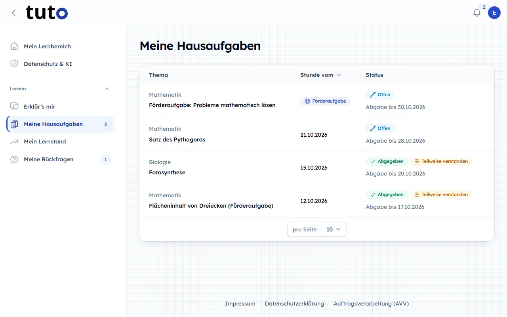<br>
  <sub>Meine Hausaufgaben</sub>
</p>

<p align="center">
  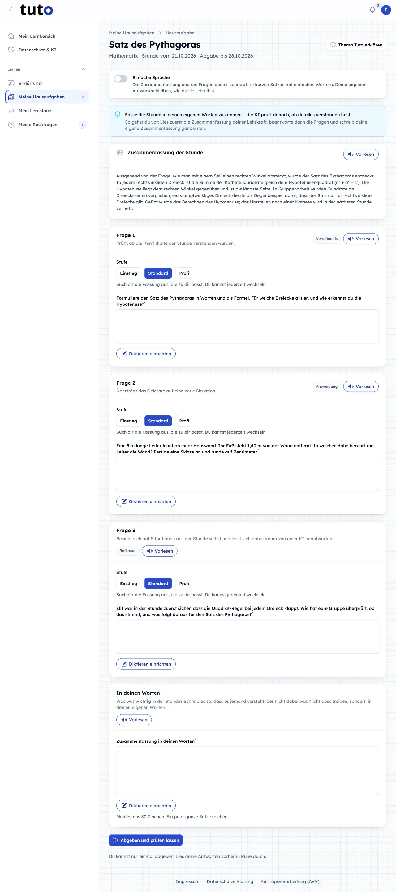<br>
  <sub>Hausaufgabe bearbeiten</sub>
</p>

<p align="center">
  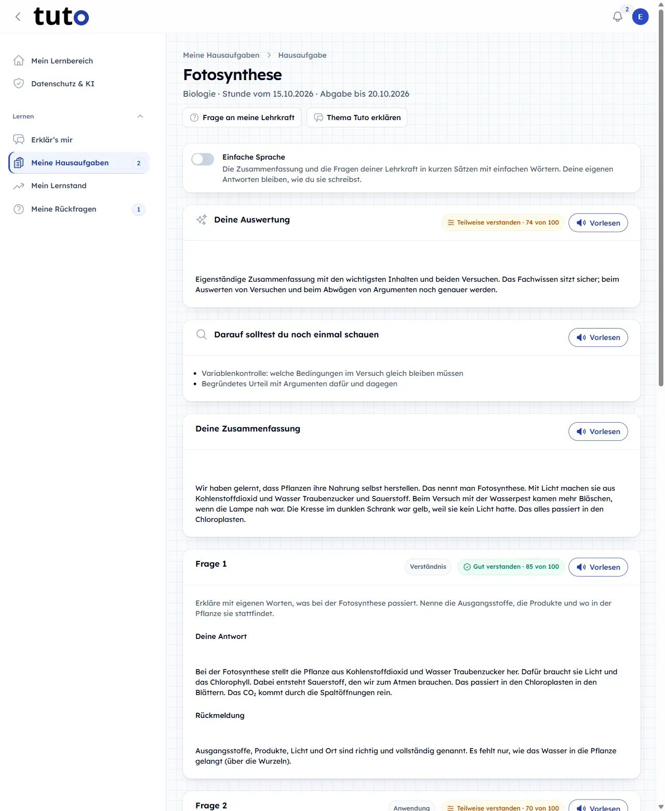<br>
  <sub>Auswertung einer Hausaufgabe</sub>
</p>

#### Stufe wählen und Einfache Sprache

- **Stufe:** Bei Fragen mit Stufen wählst du über der Antwort zwischen **„Einstieg“**, **„Standard“** und **„Profi“**. Such dir die Fassung aus, die zu dir passt, du kannst jederzeit wechseln. Die Stufe, mit der du abgibst, wird mit gespeichert. Bewertet wird dein Verständnis, die Stufe ist keine Note.
- **Einfache Sprache:** Oben auf der Seite schaltest du **„Einfache Sprache“** ein. Dann stehen die Zusammenfassung und die Fragen deiner Lehrkraft in kurzen Sätzen mit einfachen Wörtern da. Deine eigenen Antworten bleiben, wie du sie schreibst. Die KI sieht dabei nur die Texte deiner Lehrkraft, nie deine Antworten. Ob der Schalter an ist, merkt sich nur dein Browser.

<p align="center">
  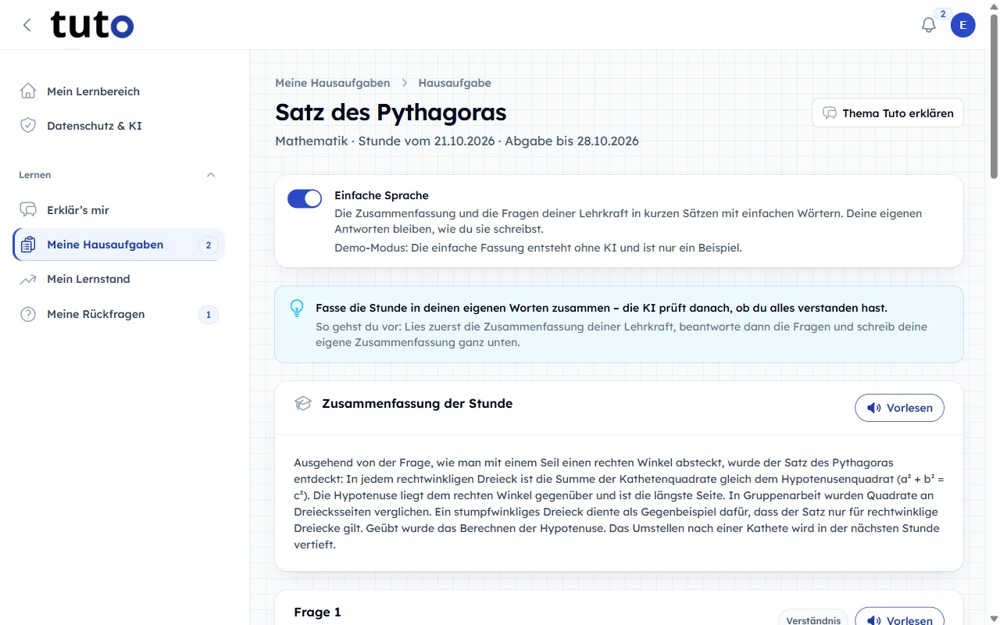<br>
  <sub>Hausaufgabe mit Einfacher Sprache</sub>
</p>

#### Vorlesen und Diktieren

An Überschriften von Abschnitten und an Texten steht ein Knopf **„Vorlesen“**, an Textfeldern **„Diktieren“**. Beides läuft auf deinem Gerät und im Browser: Das Vorlesen nutzt die deutsche Stimme deines Geräts. „Diktieren“ erscheint nur, wenn dein Browser bestätigt, dass er Deutsch auf dem Gerät erkennen kann (beim ersten Mal lädt er dafür ein Sprachpaket, „Diktieren einrichten“). Nichts davon wird an einen anderen Dienst gesendet.

#### Förderaufgabe bearbeiten

Gibt dir deine Lehrkraft eine Förderaufgabe, erscheint sie unter Meine Hausaufgaben mit dem Zeichen „Förderaufgabe“ statt eines Stundendatums und als Meldung in der Glocke. Unter **Mein Lernstand** steht sie bei der passenden Kompetenz („Förderaufgabe bearbeiten zu …“). Du bearbeitest sie wie eine Hausaufgabe; deine eigene Zusammenfassung („Was du jetzt über … weißt“) braucht mindestens 40 Zeichen.

#### Erklär’s mir

**So erreichst du es:** Seitenleiste → Lernen → Erklär’s mir (`/erklaer-es-mir`), oder auf der Hausaufgabe oben rechts den Knopf zu Erklär’s mir (dann ist die Stunde schon gewählt)

Wer etwas erklären kann, hat es wirklich verstanden. Dein KI-Lernpartner kennt das Thema noch nicht, ist neugierig und fragt nach.

1. Wähle bei „Thema aus deinen Hausaufgaben“ eine Stunde („Stunde auswählen“) oder schreibe bei „Oder ein eigenes Thema“ selbst eins auf. Klicke auf „Los geht’s“.
2. Erkläre das Thema in deinen eigenen Worten unter „Deine Erklärung“ und schicke es mit „Senden“ oder Enter ab (Shift + Enter macht eine neue Zeile). Dein Lernpartner stellt eine Rückfrage, du antwortest, und so weiter.
3. Bist du fertig, klicke auf **„Erklärung beenden“** und bestätige mit „Ja, beenden“. Du siehst deine **Auswertung** mit Wert und Rückmeldung. Danach kannst du in diesem Gespräch nichts mehr schreiben.
4. Unter „Deine Erklärungen“ findest du frühere Gespräche. „Neue Erklärung“ startet ein neues, „Gespräch löschen“ löscht eins endgültig.

Zu Themen aus deinen Hausaufgaben kannst du außerdem deiner Lehrkraft eine Frage stellen (nächster Abschnitt). Lehrkräfte sehen Gespräche zu ihren Stunden. Gespräche zu einem eigenen Thema bleiben bei dir.

<p align="center">
  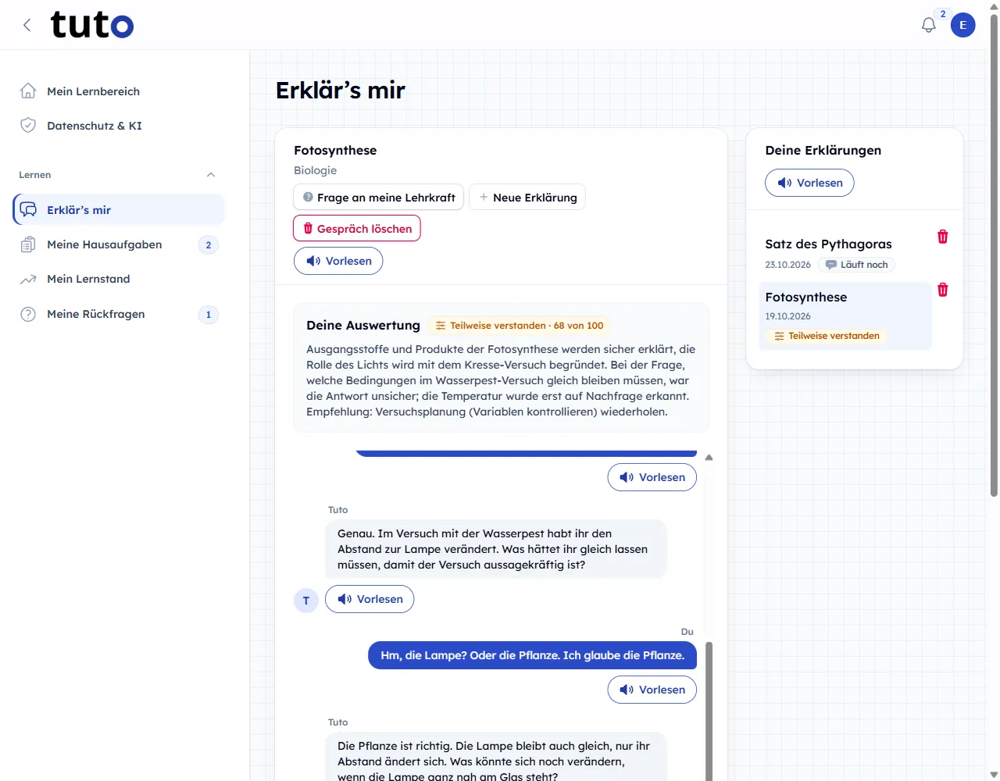<br>
  <sub>Erklär’s mir</sub>
</p>

#### Frage an die Lehrkraft

**So erreichst du es:**

- Auf dem **Ergebnis einer Hausaufgabe**: oben rechts „Frage an meine Lehrkraft“ (erst, wenn die Hausaufgabe ausgewertet ist), oder
- in **Erklär’s mir**: im Gespräch zu einer Stunde aus deinen Hausaufgaben „Frage an meine Lehrkraft“.

1. Schreibe unter „Deine Frage“, was du wissen möchtest, und klicke auf „Frage abschicken“. Bitte keine privaten Angaben.
2. Deine Lehrkraft bekommt eine Meldung. Lesen können deine Frage nur sie und die Schuladministration, deine Mitschüler:innen nicht.
3. Zu einer Stunde darfst du höchstens fünf Fragen offen haben. Warte dann auf die Antworten.

**Die Antwort findest du unter** Seitenleiste → Lernen → **Meine Rückfragen** (`/meine-rueckfragen`). Eine Zahl am Menüpunkt zeigt neue Antworten. Der Status sagt „Wartet auf Antwort“, „Neue Antwort“, „Gelesen“ oder „Erledigt“ (deine Lehrkraft hat die Frage im Unterricht besprochen). Klicke auf „Gelesen“, wenn du die Antwort gelesen hast.

<p align="center">
  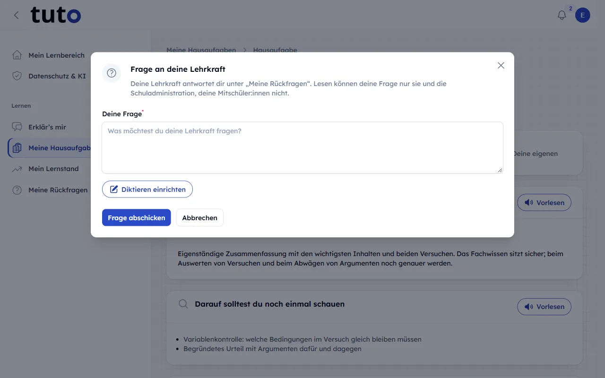<br>
  <sub>Frage an die Lehrkraft</sub>
</p>

<p align="center">
  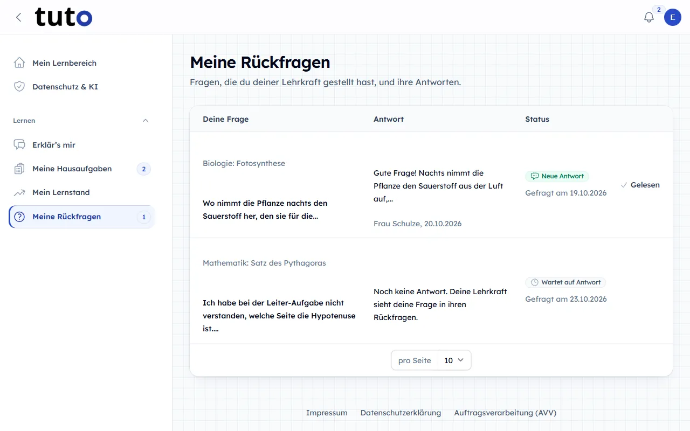<br>
  <sub>Meine Rückfragen</sub>
</p>

#### Mein Lernstand und Nachholbedarf

**So erreichst du es:** Seitenleiste → Lernen → Mein Lernstand (`/mein-lernstand`)

Das sind Hinweise aus deinen Hausaufgaben, keine Noten. Du siehst nur deine eigenen Ergebnisse und wirst mit niemandem verglichen.

1. Oben stehen „Dein Verständnis im Durchschnitt“, die „Entwicklung“ („Es geht aufwärts“, „Ziemlich gleich geblieben“, „Zuletzt etwas niedriger“) und wie viele Hausaufgaben bisher bewertet sind.
2. Darunter stehen die Kompetenzen: was schon gut klappt, was fast sitzt und wo sich Üben lohnt. Bei Kompetenzen mit Nachholbedarf findest du die Förderaufgabe deiner Lehrkraft, falls sie eine gegeben hat, „Ergebnis ansehen“ zu den Hausaufgaben, bei denen es noch gehakt hat, und einen Weg zu Erklär’s mir.

<p align="center">
  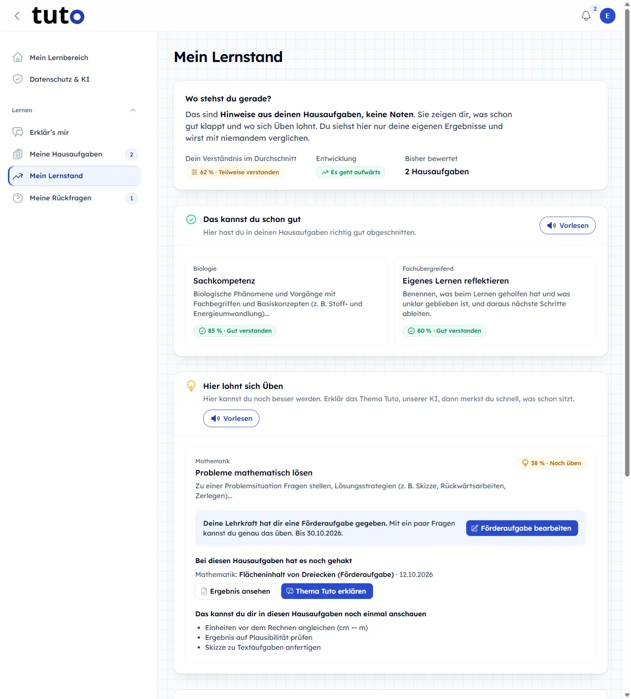<br>
  <sub>Mein Lernstand</sub>
</p>

#### Einwilligungsübersicht: Tuto-Mikro im Unterricht

**So erreichst du es:** Seitenleiste → Lernen → Tuto-Mikro im Unterricht (`/tuto-mikro-im-unterricht`). Der Menüpunkt erscheint nur, wenn deine Schule das Tuto-Mikro freigeschaltet hat und verlangt, dass auch du selbst zustimmst.

Manchmal schaltet deine Lehrkraft im Unterricht das Tuto-Mikro ein. Es erfasst nur den Ton, es gibt kein Bild und kein Video, und daraus entstehen Notizen aus der Stunde. Das geht nur, wenn deine Eltern eingewilligt haben und die ganze Klasse einverstanden ist.

1. Oben steht „Einwilligung deiner Eltern“: „Liegt vor“ oder der Stand („Fehlt“, „Widerrufen“, „Veraltet“ …).
2. Liegt sie vor, siehst du bei „Dein Einverständnis“, ob du schon Ja gesagt hast. Klicke auf **„Ich bin einverstanden“**, wenn du zustimmst.
3. Du kannst jederzeit deine Meinung ändern: **„Ich bin nicht mehr einverstanden“**. Dir passiert dadurch nichts. Solange du nicht zustimmst, bleibt das Tuto-Mikro in deiner Klasse aus.

<p align="center">
  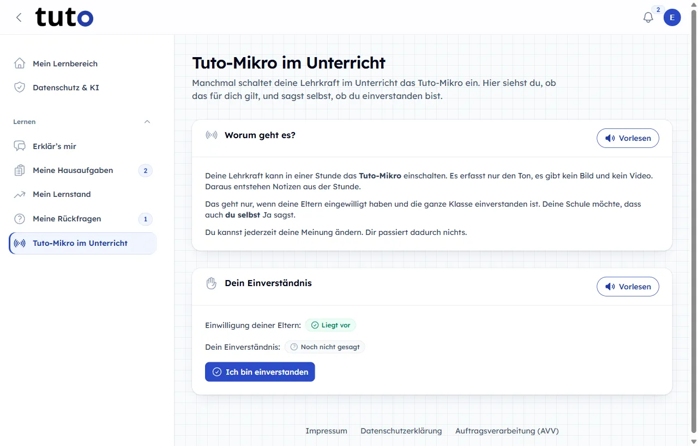<br>
  <sub>Tuto-Mikro im Unterricht, Sicht der Schüler:in</sub>
</p>

#### Daten herunterladen

**So erreichst du es:** Benutzermenü oben rechts → Profil → oben rechts **„Meine Daten herunterladen“**

Du bekommst alles, was zu deinem Konto gespeichert ist, als Datei (JSON). Fragen zu Berichtigung und Löschung beantwortet die Schulverwaltung deiner Schule.

#### Sprache wechseln

Benutzermenü oben rechts → „Sprache: English“ ([mehr dazu](#profil-und-sprache)).

---

### 4.6 Eltern

Eltern brauchen kein Konto. Sie bekommen von der Lehrkraft einen Brief mit persönlichem Link und QR-Code.

**So erreichst du es:** Link aus dem Brief öffnen oder den QR-Code scannen (`/einwilligung/{persönlicher Code}`)

1. Die Seite nennt die Schule, den Vornamen und die Klasse des Kindes und den Einwilligungstext.
2. Wähle, welchen Zwecken du zustimmst. **Der Ton ist immer dabei**, denn Notizen und Spracherkennung bauen darauf auf. Die weiteren Zwecke, die die Schule in ihren Text aufgenommen hat (Notizen aus der Stunde, KI-Anbieter für Spracherkennung und Zusammenfassung), sind einzeln wählbar.
3. Trage deinen Namen ein, bestätige, dass du erziehungsberechtigt bist, und sende die Einwilligung ab.
4. **Widerruf:** Auf demselben Link kannst du jederzeit widerrufen. Danach bleibt das Mikro in jeder Stunde aus, in der dein Kind dabei ist, bis du neu einwilligst.

Die Seite braucht keine Anmeldung und legt keine Sitzung an. Sie verrät über das Kind nichts außer Vorname und Klasse.

<p align="center">
  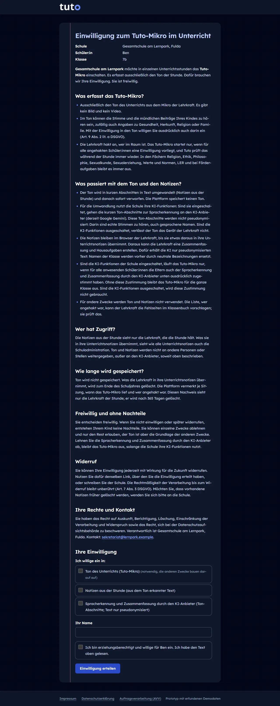<br>
  <sub>Einwilligungsseite für Eltern</sub>
</p>

---

## 5. Datenschutz

Die wichtigsten Regeln im Überblick. Die ausführlichen Texte stehen in der Anwendung:

- **Datenschutz & KI** (Seitenleiste): Was gespeichert wird, wer es sieht und was die KI damit macht, für alle Rollen
- **Datenschutz-Unterlagen** (Verwaltung bzw. Plattform): Checkliste, Folgenabschätzung, Verzeichnis, Elterninformation, Einwilligung
- öffentlich ohne Anmeldung: `/impressum`, `/datenschutzerklaerung`, `/auftragsverarbeitung` (der AVV)
- für die Schuladministration: `/meine-schule/auftragsverarbeitung` (der AVV mit den Daten der eigenen Schule) und `/meine-schule/auftragsverarbeitung/angenommen` (die angenommene Fassung)

**Pseudonymisierung.** Bevor ein Text zur KI geht, ersetzt Tuto die Namen der Schüler:innen und Lehrkräfte durch neutrale Bezeichnungen („Schüler:in A“, „Lehrkraft“). Benutzernamen und Benutzer-IDs gehen nie mit. Die Lehrkraft prüft Texte vor jeder Auswertung. Grenzen: Namen anderer Personen und Spitznamen kennt Tuto nicht, und was in einem Text selbst steht, wird unverändert übertragen. Arbeitsblatt-Dateien (Fotos, PDF) lassen sich nicht pseudonymisieren: Es sollten keine Namen darauf stehen.

**Die KI ist pro Schule freiwillig.** Ohne Einschalten durch die Schuladministration (Checkliste mit Auftragsverarbeitung, bezahltem Tarif, Folgenabschätzung, Information der Eltern) und ohne Plattformschalter verlässt kein Text die Plattform. Dann antwortet die Demo-Logik.

**Kein Ton wird gespeichert.** Das Tuto-Mikro nutzt nur das Mikrofon der Lehrkraft, nur Ton, nie Bild. Ton-Abschnitte laufen, wenn überhaupt, nur durch den Arbeitsspeicher zur Spracherkennung, und das nur, wenn die KI der Schule an ist. Dann ist die Zustimmung der Eltern zum Zweck „Spracherkennung und Zusammenfassung durch den KI-Anbieter“ Voraussetzung für „Mikro an“. Ist die KI aus, bleibt der Ton auf dem Gerät der Lehrkraft. Die Notizen bleiben im Fenster der Lehrkraft. Gespeichert wird nur, was sie in die Stundennotizen übernimmt (mit ersetzten Namen). Der Nachweis je Sitzung enthält nur Zeit, Dauer und Anwesenheit und wird nach 365 Tagen gelöscht. Die Beamer-Anzeige zeigt nur „Mikro an“ oder „Mikro aus“ und das Thema.

**Einwilligungs-Prüfung.** Das Mikro geht nur an, wenn alle Bedingungen zugleich erfüllt sind:

- Die Schule hat Tuto-Mikro freigeschaltet (Checkliste bestätigt, Einwilligungstext veröffentlicht, AVV angenommen) und ist nicht gesperrt.
- Die Lehrkraft unterrichtet die Klasse (Klassenleitung, zugeordnet oder heute als Vertretung).
- Die Stunde ist keine Förderaufgabe, und ihr Fach steht nicht auf der Liste der gesperrten Fächer.
- Für **jede** angehakte Schüler:in liegt eine gültige Einwilligung vor: erteilt, nicht widerrufen, für die aktuelle Fassung des Textes, mit allen nötigen Zwecken und, wo die Schule es verlangt, mit der eigenen Zustimmung der Schüler:in.
- Die Lehrkraft hat bestätigt, dass nur die Angehakten im Raum sind.

**Aufbewahrung.** Stunden mit Fragen, Abgaben und Antworten, Erklär’s-mir-Gespräche und Klassenbuch-Einträge werden zum Ende des Schuljahres gelöscht (`LERNPLATTFORM_SCHOOL_YEARS_KEPT=1`, Schuljahresbeginn `08-01`). Bis zum 1.8.2027 bleiben noch zwei Schuljahre gespeichert, weil bisherige Verträge das versprechen. Der Nachweis je Tuto-Mikro-Sitzung bleibt 365 Tage, gelesene Meldungen 14 Tage, alle Meldungen höchstens 60 Tage. Eine Vertretung endet von selbst und dauert höchstens 90 Tage. Alle Fristen stehen in `config/lernplattform.php`.

**Datenauskunft.** Jede Person lädt ihre Daten selbst herunter (Profil → „Meine Daten herunterladen“). Die Schuladministration kann das für Konten ihrer Schule tun (Benutzer → Konto → „Datenauskunft“). Die Datei der Person selbst enthält auch die Zugänge verbundener Apps (Name, Verbindung, letzte Nutzung, Ablauf, Berechtigungen), nie den Zugangsschlüssel.

**Verbundene Apps.** Lehrkräfte und Schuladministrationen können eine App mit ihrem Konto verbinden ([Abschnitt 7](#7-app-anbindung)). Die App sieht und ändert nur Stunden und Klassen der Person und nie Daten von Schüler:innen. Tuto speichert den Einmal-Code (5 Minuten gültig) und den Zugangsschlüssel (180 Tage gültig) nur als Hash, dazu Name, Berechtigungen, Verbindung, letzte Nutzung und Ablauf des Zugangs, keine IP-Adresse. Beides wird mit dem Konto gelöscht, ein Zugang auch sofort, wenn die Person ihn im Profil entzieht oder ihr Passwort ändert.

**Wer sieht was.** Alles, was zu einer Schule gehört, sehen nur Personen dieser Schule. Die Plattform-Administration sieht keine Lerndaten. Lehrkräfte sehen die Ergebnisse, Rückmeldungen der KI und Lernstände zu ihren eigenen Stunden und den Klassen, die sie unterrichten, bis hin zum Bericht für das Elterngespräch. Die Schuladministration sieht alle Stunden und Ergebnisse ihrer Schule. Schüler:innen sehen nur ihre eigenen Daten. Mit dem Ende einer Vertretung endet auch der Zugriff der Vertretung.

**Auftragsverarbeitung (AVV).** Jede Schule nimmt den Vertrag im Namen der Schule an (bei der Registrierung oder unter Meine Schule). Gespeichert werden Version, Zeitpunkt, Vertragstext und die annehmende Person. Ohne angenommenen Vertrag kann eine Schule nur „Meine Schule“ nutzen. Ein neuer oder geänderter Vertragstext wird von jeder Schule neu angenommen. Das gilt auch, wenn sich Werte ändern, die der Vertragstext aus den Einstellungen der Plattform übernimmt, zum Beispiel eine Frist oder der KI-Anbieter. Bis zur Annahme gilt die zuletzt angenommene Fassung weiter.

**Weiteres.** Die Schrift (Lexend) liegt auf dem Server, es gibt keine Anfrage an ein Schriftarten-Netzwerk. Der QR-Code der Elternbriefe wird auf dem Server erzeugt und nicht bei einem Dienst im Netz. Die öffentlichen Rechtsseiten und die Einwilligungsseite für Eltern legen keine Sitzung an.

---

## 6. Betrieb

### Bereitstellen

- Das `Dockerfile` baut ein Image mit PHP 8.4, Nginx (serversideup/php) und den gebauten Oberflächen-Dateien. Es installiert `pdo_mysql`, für den Betrieb ist MariaDB gedacht. Proxy-Header werden akzeptiert, vorgesehen ist der Betrieb hinter einem Reverse-Proxy (Coolify mit Traefik).
- Setze in der Umgebung `APP_ENV=production`, `APP_DEBUG=false`, eine `APP_URL` mit **https**, die Datenbank, den Mail-Versand, `APP_LOCALE=de`, `LERNPLATTFORM_LOCALE=de` und, falls die KI laufen soll, den KI-Zugang. Das Tuto-Mikro funktioniert nur über https, denn nur dann gibt der Browser das Mikrofon frei. Setze bei https auch `SESSION_SECURE_COOKIE=true`.
- **Reihenfolge bei jedem Ausrollen:** zuerst `php artisan migrate --force`, danach `php artisan db:seed --force`. Der Seeder ist wiederholbar: Kompetenzraster, Demo-Stunden und Demo-Daten legt er nur an, wenn sie fehlen. Die Demo-Konten dagegen setzt er bei **jedem** Lauf zurück (Passwort `hackathon2026`, Rolle, Schule, Klasse), auch den Plattform-Zugang `hackathon`, und gelöschte Demo-Konten entstehen neu.
- **Demo-Zugänge entfernen.** Die [Demo-Zugänge](#demo-zugänge) sind nur zum Ausprobieren. Für einen echten Betrieb: Demo-Schulen und Demo-Konten löschen und den Seeder nicht mehr mit den Demo-Daten laufen lassen (nimm `DemoSchoolSeeder` aus `database/seeders/DatabaseSeeder.php` und lege den eigenen Plattform-Zugang an, statt `hackathon` zu behalten). Entferne außerdem auf der Anmeldeseite die Demo-Zugänge samt Passwort: in `app/Filament/Pages/Auth/Login.php` die Liste `DEMO_ACCOUNTS` (und den Block „Demo-Zugänge“) **und** die beiden `->default(...)` in `form()`, die Benutzername `hackathon` und das Demo-Passwort schon ins Formular schreiben.
- **Rechtsseiten ersetzen.** Impressum, Datenschutzerklärung und AVV sind für den Anbieter des Prototyps geschrieben (Softwareentwicklung Sebastian Bleuel). Impressum und Datenschutzerklärung sagen außerdem, dass die Plattform nur erfundene Demodaten enthält und niemand echte personenbezogene Daten eingeben soll (auch die Fußzeile der Rechtsseiten trägt ihn: „Prototyp mit erfundenen Demodaten“). Ersetze vor dem echten Betrieb Anbieter, Verantwortlichen, Kontaktdaten und den Demo-Hinweis in `resources/views/filament/legal/imprint.blade.php`, `privacy.blade.php`, `avv-contract.blade.php` und `layout.blade.php` durch deine eigenen, lass die Texte rechtlich prüfen und erhöhe danach `dpa.version` in `config/lernplattform.php`, damit jede Schule den neuen Vertrag annimmt.
- Die Sitzung läuft nach 120 Minuten ohne Aktivität ab (`SESSION_LIFETIME`).

### Zeitplaner (Pflicht)

Ohne Zeitplaner werden Daten nicht gelöscht. Er muss jede Minute `php artisan schedule:run` ausführen (Cron) oder dauerhaft `php artisan schedule:work` laufen (zweiter Prozess im Container). Er führt täglich aus:

| Zeit | Befehl | Was er tut |
| --- | --- | --- |
| täglich | `auth:clear-resets` | löscht abgelaufene Passwort-Links |
| 03:30 | `lernplattform:prune-learning-data` | löscht Stunden, Abgaben, Gespräche und Klassenbuch-Einträge nach der Aufbewahrungsfrist |
| 03:45 | `lernplattform:prune-recordings` | löscht Tuto-Mikro-Nachweise nach 365 Tagen und liegen gebliebene Ton-Dateien |
| 04:00 | `lernplattform:prune-notifications` | löscht alte Meldungen und die gelöschter Konten |
| täglich | `sanctum:prune-expired --hours=24` | löscht Zugänge verbundener Apps, die seit mehr als einem Tag abgelaufen sind |
| täglich | `model:prune` (nur `AppAuthorizationCode`) | löscht benutzte und abgelaufene Einmal-Codes vom Verbinden einer App |

Die beiden Aufräum-Befehle für Lerndaten und Tuto-Mikro kennen `--dry-run`: Sie zählen nur und löschen nichts. Probiere das vor dem ersten echten Lauf aus. Eine fehlerhafte Einstellung der Fristen führt nie zum Löschen von allem, sondern zu einer Fehlermeldung.

### Protokolle

Setze `LOG_STACK=daily`, damit das Protokoll täglich wechselt (`LOG_DAILY_DAYS` bestimmt, wie viele Tage bleiben). Mit dem Standard `single` wächst eine einzige Datei ohne Ende.

### KI im Betrieb

- Für echte Schuldaten brauchst du bei Gemini einen **bezahlten Tarif**, bei dem Eingaben nicht zur Produktverbesserung genutzt werden. Im kostenlosen Tarif darf Google Eingaben dafür verwenden, Texte von Kindern gehören dort nicht hin.
- `AI_TIMEOUT` (Standard 120 Sekunden) begrenzt, wie lange die Plattform auf die KI wartet. Schlägt die KI fehl, bleibt alles gespeichert, und die Lehrkraft oder die Schüler:in kann es erneut versuchen.
- `LERNPLATTFORM_DPA_FINAL` steht ohne Eintrag auf `true`: Der AVV ist freigegeben und jede Schule kann ihn annehmen. Solange der Text ein Entwurf ist, setze `LERNPLATTFORM_DPA_FINAL=false`. Dann können Schulen ihn lesen, aber nicht annehmen.
- Der AVV-Text übernimmt Werte aus den Einstellungen, zum Beispiel Aufbewahrungsfristen und KI-Anbieter. Ändert sich so ein Wert (etwa `AI_ENABLED`, `AI_PROVIDER`, eine Aufbewahrungsfrist, `SESSION_LIFETIME` oder `SESSION_SECURE_COOKIE`), gilt der Vertrag als geändert, und jede Schule nimmt die geänderte Fassung unter Meine Schule neu an. Lege diese Werte deshalb vor dem Start fest und ändere sie später nur bewusst.

### Tests

```bash
php artisan test --compact                           # alle Tests
php artisan test --compact tests/Feature/PermissionTest.php
php artisan test --compact --filter=Name             # gezielt
composer test                                        # Konfiguration leeren, dann alle Tests
vendor/bin/pint --dirty --format agent               # Formatierung der geänderten Dateien
```

Die Tests laufen mit einer SQLite-Datenbank im Arbeitsspeicher, ohne Zugang zu einer KI: `phpunit.xml` setzt `AI_ENABLED=false` und `LERNPLATTFORM_DPA_FINAL=false`, und die KI wird in Tests nur durch Attrappen des SDK ersetzt. **Es wird in Tests nie eine echte KI aufgerufen**, dafür brauchst du keinen Schlüssel.

---

## 7. App-Anbindung

Eine Smartphone-App, derzeit die „Tuto-App“, kann sich mit dem Konto einer Lehrkraft oder der Schuladministration verbinden. Sie zeigt die eigenen Stunden, legt neue Stunden an und setzt die Zusammenfassung einer Stunde. Die Verbindung baut auf Laravel Sanctum auf. Die App öffnet die Anmeldeseite von Tuto im Browser und bekommt am Ende einen Zugang. Das Passwort sieht sie nie.

### 7.1 Für Lehrkräfte: App verbinden und Zugang entziehen

Verbinden können **Lehrkräfte und Schuladministrationen**. Schüler:innen und die Plattform-Administration können keine App verbinden, auch niemand, dessen Schule gesperrt ist oder den AVV noch nicht angenommen hat.

#### App verbinden

**So erreichst du es:** Du startest das Verbinden in der App. Sie öffnet im Browser deines Handys die Tuto-Seite `/app/verbinden`.

1. Melde dich auf der Anmeldeseite von Tuto an, wie sonst auch. Bist du schon angemeldet, entfällt das. Dein Passwort gibst du nur hier ein, nie in der App.
2. Die Seite „Tuto-App mit Tuto verbinden“ zeigt, was die App **darf**: deine Stunden und Klassen sehen (als Schuladministration die Stunden und Klassen deiner Schule), neue Stunden anlegen und die Zusammenfassung einer Stunde setzen. Und was sie **nicht darf**: Daten deiner Schüler:innen sehen, Ergebnisse und Abgaben sehen, dein Passwort erfahren.
3. Klicke auf **„Erlauben“**. Mit „Abbrechen“ passiert nichts, die App bekommt keinen Zugang.
4. Der Browser wechselt zurück in die App. Damit ist sie verbunden.

Zeigt Tuto statt der Zustimmung eine Fehlerseite, war die Anfrage ungültig, oder dein Konto darf keine App verbinden. Starte das Verbinden dann in der App noch einmal.

Gut zu wissen:

- Die Zusammenfassung, die die App setzt, lesen deine Schüler:innen vor den Fragen. Schreibe keine Namen oder persönlichen Angaben zu einzelnen Schüler:innen hinein.
- Ein neuer KI-Entwurf lässt eine Zusammenfassung aus der App stehen und erstellt nur die Fragen. Die KI liest die Zusammenfassung dabei weiter, sofern deine Schule die KI eingeschaltet hat. Du kannst sie vor der Freigabe auf der Stundenseite anpassen.
- Stunden, die die App anlegt, gehören dir. Notizen kann die App mitgeben. Fehlen sie, trägst du sie in Tuto nach: Beim Speichern der Stunde in Tuto sind Notizen Pflicht.

#### Zugang entziehen

**So erreichst du es:** Benutzermenü oben rechts → Profil (`/profile`) → Abschnitt „Verbundene Apps“

1. Die Liste zeigt jede verbundene App mit dem Namen, den die App für das Gerät angegeben hat (zum Beispiel „iPhone von Frau Schulze“), dem Tag der Verbindung, wann sie zuletzt genutzt wurde und bis wann der Zugang gilt.
2. Klicke bei der App auf **„Zugang entziehen“** und bestätige. Die App kann danach nichts mehr in Tuto ansehen oder ändern, bis du sie neu verbindest.

Ein Zugang gilt 180 Tage, danach verbindest du die App noch einmal. Hast du das Handy verloren, entziehe den Zugang sofort. Er hört auch auf zu gelten, solange deine Schule gesperrt ist oder den AVV neu annehmen muss, und wenn dein Konto nicht mehr Lehrkraft oder Schuladministration ist. Bekommt dein Konto ein neues Passwort (von dir, über den Link zum Zurücksetzen oder von der Schuladministration), enden alle verbundenen Apps, und du verbindest sie mit dem neuen Passwort neu. Mit dem Konto wird ein Zugang gelöscht.

### 7.2 Für App-Entwickler:innen

#### Überblick und Einrichtung

- Die Schnittstelle liegt unter `https://<deine-tuto-adresse>/api/v1`. Alle Antworten sind JSON, sende immer `Accept: application/json`.
- Es gibt **keine Anmeldung mit Passwort**. Eine App bekommt ihren Zugang nur über den Ablauf unten: OAuth 2.0 mit Einmal-Code („Authorization Code“) und PKCE (RFC 7636, nur die Methode `S256`), wie für native Apps vorgesehen (RFC 8252). Die Zugänge sind Sanctum-Tokens (`Authorization: Bearer …`).
- Registrierte Apps stehen in `config/lernplattform.php` unter `apps.clients`. Der Schlüssel ist die `client_id` (`tuto-app`), `name` steht auf der Zustimmungsseite. Die `redirect_uris` kommen aus `LERNPLATTFORM_APP_REDIRECT_URIS` (kommagetrennt, Standard `tutoapp://callback`). Die `redirect_uri` einer Anfrage muss genau einer davon entsprechen, es gibt keine Platzhalter. Für eine weitere App legst du einen weiteren Eintrag unter `clients` an.
- `SANCTUM_EXPIRATION` bestimmt in Minuten, wie lange ein Zugang gilt (Standard 259200, also 180 Tage).
- Die Datenbank braucht die Tabellen `personal_access_tokens` und `app_authorization_codes` (`php artisan migrate`), und der [Zeitplaner](#zeitplaner-pflicht) räumt abgelaufene Zugänge und Codes auf.

#### Ablauf: App verbinden

1. **Vorbereiten.** Die App erzeugt einen zufälligen `code_verifier` (43 bis 128 Zeichen aus `A-Z a-z 0-9 - . _ ~`), bildet daraus die `code_challenge` als `BASE64URL(SHA-256(code_verifier))` ohne `=` am Ende (immer 43 Zeichen) und erzeugt einen zufälligen `state`.
2. **Browser öffnen.** Die App öffnet im System-Browser (nicht in einer eingebetteten Ansicht) `GET /app/verbinden` mit diesen Parametern:

   | Parameter | Inhalt |
   | --- | --- |
   | `client_id` | Die registrierte App, zum Beispiel `tuto-app`. |
   | `redirect_uri` | Eine der registrierten Rückkehr-Adressen, zum Beispiel `tutoapp://callback`. |
   | `code_challenge` | Die 43 Zeichen aus Schritt 1. |
   | `code_challenge_method` | Immer `S256`. |
   | `state` | Ein zufälliger Wert der App (höchstens 500 Zeichen). Tuto gibt ihn unverändert zurück. |

   ```text
   https://tuto.example.org/app/verbinden?client_id=tuto-app&redirect_uri=tutoapp%3A%2F%2Fcallback&code_challenge=E9Melhoa2OwvFrEMTJguCHaoeK1t8URWbuGJSstw-cM&code_challenge_method=S256&state=af0ifjsldkj
   ```

   Ist die Person nicht angemeldet, leitet Tuto zur normalen Anmeldeseite und danach zu genau dieser Adresse zurück. Eine Anfrage mit unbekannter `client_id`, nicht registrierter `redirect_uri`, fehlendem oder falschem PKCE-Parameter oder ohne `state` zeigt eine Fehlerseite und leitet nie weiter. Schüler:innen, die Plattform-Administration, gesperrte Schulen und Schulen ohne angenommenen AVV bekommen eine Erklärung statt der Zustimmung.
3. **Zurück in die App.** Nach „Erlauben“ leitet Tuto den Browser zu `redirect_uri` weiter, mit dem Einmal-Code: `tutoapp://callback?code=<64 Zeichen>&state=af0ifjsldkj`. Nach „Abbrechen“ lautet die Adresse `tutoapp://callback?error=access_denied&state=af0ifjsldkj`. Die App prüft, dass `state` stimmt. Der Code gilt **5 Minuten** und lässt sich **einmal** einlösen. Hat die `redirect_uri` schon eine Query, hängt Tuto die Parameter mit `&` an.
4. **Code gegen den Zugang tauschen.** `POST /api/v1/token`, JSON oder Formular, höchstens 10 Anfragen pro Minute und IP-Adresse (danach 429). Auch ein Versuch mit falschem `code_verifier` oder falscher `redirect_uri` verbraucht den Code: Bei einem Fehler beginnt die App von vorn.

   | Feld | Inhalt |
   | --- | --- |
   | `grant_type` | Immer `authorization_code`. |
   | `code` | Der Einmal-Code aus Schritt 3. |
   | `client_id` | Wie in Schritt 2. |
   | `redirect_uri` | Genau wie in Schritt 2. |
   | `code_verifier` | Der `code_verifier` aus Schritt 1. |
   | `device_name` | Name des Geräts, höchstens 100 Zeichen. Er steht im Profil unter „Verbundene Apps“, zum Beispiel „iPhone von Frau Schulze“. |

   ```bash
   curl -X POST https://tuto.example.org/api/v1/token \
     -H "Accept: application/json" \
     -H "Content-Type: application/json" \
     -d '{
       "grant_type": "authorization_code",
       "code": "<Einmal-Code aus Schritt 3>",
       "client_id": "tuto-app",
       "redirect_uri": "tutoapp://callback",
       "code_verifier": "dBjftJeZ4CVP-mB92K27uhbUJU1p1r_wW1gFWFOEjXk",
       "device_name": "iPhone von Frau Schulze"
     }'
   ```

   Die Antwort (201) enthält den Zugang genau dieses eine Mal, Tuto speichert nur einen Hash davon:

   ```json
   {
     "token": "7|Qk3w…",
     "token_type": "Bearer",
     "abilities": ["lessons:read", "lessons:create", "lessons:summary"],
     "expires_at": "2027-04-23T10:15:00+00:00",
     "user": { "name": "Frau Schulze", "role": "teacher" }
   }
   ```

   Das Feld heißt `token` (nicht `access_token`), es gibt kein `expires_in` und keinen Refresh-Token. Der Name und die Rolle der Person kommen mit, ihre E-Mail-Adresse nicht. Läuft der Zugang ab oder antwortet die Schnittstelle mit 401, verbindet die App die Person neu.

Den Zugang schickt die App bei jeder weiteren Anfrage mit:

```bash
curl https://tuto.example.org/api/v1/classes \
  -H "Accept: application/json" \
  -H "Authorization: Bearer 7|Qk3w…"
```

#### Berechtigungen und Lebensdauer

Jeder Zugang trägt immer alle drei Berechtigungen (Abilities). Jede Route prüft ihre eigene.

| Berechtigung | Erlaubt |
| --- | --- |
| `lessons:read` | `GET /classes`, `GET /lessons`, `GET /lessons/{id}` |
| `lessons:create` | `POST /lessons` |
| `lessons:summary` | `PUT /lessons/{id}/summary` |

Ein Zugang gilt 180 Tage ab dem Verbinden, auch wenn er täglich genutzt wird. Die Person entzieht ihn im Profil, die App mit `DELETE /api/v1/token`. Ein neues Passwort des Kontos löscht alle seine Zugänge und offenen Einmal-Codes. Außerdem prüft Tuto bei **jeder** Anfrage, ob das Konto noch Lehrkraft oder Schuladministration ist und die Schule weder gesperrt ist noch den AVV neu annehmen muss. Sonst antwortet es mit 403, ohne den Zugang zu löschen.

#### Schnittstellen

Alle Pfade stehen unter `/api/v1`. Antworten mit Daten haben die Form `{"data": …}`.

| Methode und Pfad | Berechtigung | Was sie tut |
| --- | --- | --- |
| `POST /token` | keine, siehe oben | tauscht den Einmal-Code gegen einen Zugang |
| `DELETE /token` | gültiger Zugang | entzieht den Zugang, mit dem die Anfrage kam (204) |
| `GET /classes` | `lessons:read` | Klassen, in denen die Person Stunden anlegen darf |
| `GET /lessons` | `lessons:read` | Stunden der Person, seitenweise |
| `GET /lessons/{id}` | `lessons:read` | eine Stunde |
| `POST /lessons` | `lessons:create` | legt eine Stunde an (201) |
| `PUT /lessons/{id}/summary` | `lessons:summary` | setzt die Zusammenfassung einer Stunde |

**Wer was sieht.** Lehrkräfte sehen die Klassen, die sie leiten, denen sie zugeordnet sind oder die sie gerade vertreten, und ihre eigenen Stunden. Eine Schuladministration sieht alle Klassen und alle Stunden ihrer Schule. Förderaufgaben sieht die App nie: Sie stehen nicht in der Liste, `GET /lessons/{id}` antwortet mit 404, und ihre Zusammenfassung lässt sich nicht setzen. Daten von Schüler:innen kommen in keiner Antwort vor.

**Eine Stunde** sieht so aus:

| Feld | Inhalt |
| --- | --- |
| `id` | Nummer der Stunde |
| `subject`, `topic` | Fach und Thema |
| `held_on` | Datum der Stunde, `JJJJ-MM-TT` |
| `class` | `{"id": 1, "name": "7b"}` |
| `summary` | Zusammenfassung oder `null` |
| `summary_from_app` | `true`, wenn eine App die Zusammenfassung gesetzt hat |
| `released` | `true`, wenn die Hausaufgabe zur Stunde freigegeben ist |

##### Klassen

```bash
curl https://tuto.example.org/api/v1/classes \
  -H "Accept: application/json" -H "Authorization: Bearer 7|Qk3w…"
```

```json
{ "data": [ { "id": 1, "name": "7b" } ] }
```

##### Stunden auflisten

`GET /lessons` liefert die neuesten Stunden zuerst, 15 je Seite. Optional filterst du mit `held_on` (`JJJJ-MM-TT`) und `class_id` und blätterst mit `page`.

```bash
curl "https://tuto.example.org/api/v1/lessons?held_on=2026-10-23&class_id=1&page=1" \
  -H "Accept: application/json" -H "Authorization: Bearer 7|Qk3w…"
```

```json
{
  "data": [
    {
      "id": 12,
      "subject": "Mathe",
      "topic": "Brüche erweitern",
      "held_on": "2026-10-23",
      "class": { "id": 1, "name": "7b" },
      "summary": null,
      "summary_from_app": false,
      "released": false
    }
  ],
  "links": { "first": "…?page=1", "last": "…?page=1", "prev": null, "next": null },
  "meta": { "current_page": 1, "from": 1, "last_page": 1, "per_page": 15, "to": 1, "total": 1, "path": "…", "links": [] }
}
```

`GET /lessons/{id}` liefert eine Stunde im selben Format (`{"data": {…}}`). Gehört sie der Person nicht, antwortet Tuto mit 403.

##### Stunde anlegen

`POST /lessons` legt eine Stunde in einer Klasse an, in der die Person Stunden anlegen darf (`GET /classes`). Die Person ist die Lehrkraft der Stunde. Antwort: 201 mit der Stunde.

| Feld | Inhalt |
| --- | --- |
| `school_class_id` | Pflicht, Nummer der Klasse |
| `subject`, `topic` | Pflicht, je höchstens 255 Zeichen |
| `held_on` | optional, `JJJJ-MM-TT`, Standard ist heute |
| `notes` | optional, höchstens 10000 Zeichen, Standard ist leer |

```bash
curl -X POST https://tuto.example.org/api/v1/lessons \
  -H "Accept: application/json" -H "Content-Type: application/json" \
  -H "Authorization: Bearer 7|Qk3w…" \
  -d '{"school_class_id": 1, "subject": "Mathe", "topic": "Brüche erweitern", "held_on": "2026-10-23"}'
```

##### Zusammenfassung setzen

`PUT /lessons/{id}/summary` setzt die Zusammenfassung einer Stunde, die die Person bearbeiten darf, und merkt sich, dass sie aus einer App stammt (`summary_from_app: true`). Eine frühere Fassung in Einfacher Sprache wird dabei verworfen. Das Feld `summary` ist Pflicht und hat höchstens 5000 Zeichen. Für eine Förderaufgabe antwortet Tuto mit 422. Antwort: 200 mit der Stunde.

```bash
curl -X PUT https://tuto.example.org/api/v1/lessons/12/summary \
  -H "Accept: application/json" -H "Content-Type: application/json" \
  -H "Authorization: Bearer 7|Qk3w…" \
  -d '{"summary": "Heute haben wir Brüche erweitert und gekürzt."}'
```

**Wichtig:** Eine Zusammenfassung darf **keine personenbezogenen Daten von Schüler:innen** enthalten (keine Namen, keine Leistungen). Schüler:innen lesen sie vor den Fragen der Hausaufgabe, und ein KI-Entwurf liest sie als Hintergrund, sofern die Schule die KI eingeschaltet hat. Ein neuer KI-Entwurf ersetzt sie nicht.

#### Fehler

| Status | Wann |
| --- | --- |
| 400 | Nur beim Token-Tausch: `{"error": "…", "message": "…", "error_description": "…"}`. `invalid_request`: Angaben fehlen oder sind fehlerhaft. `invalid_client`: unbekannte `client_id`. `invalid_grant`: Code unbekannt, abgelaufen oder schon benutzt, falscher `code_verifier`, andere `client_id` oder `redirect_uri` als beim Verbinden, oder das Konto darf keine App mehr verbinden. `message` und `error_description` haben denselben Text in der Standardsprache der Plattform. |
| 401 | Der Zugang fehlt, ist ungültig, entzogen oder abgelaufen. Die App verbindet die Person neu. |
| 403 | Dem Zugang fehlt die Berechtigung für die Route, das Konto darf keine App mehr nutzen (Rolle, gesperrte Schule, AVV), oder die Stunde oder Klasse gehört der Person nicht. |
| 404 | Die Stunde oder Klasse gibt es nicht. |
| 422 | Eine Eingabe ist ungültig: `{"message": "…", "errors": {"topic": ["…"]}}`. Gilt auch für die Zusammenfassung einer Förderaufgabe. |
| 429 | Zu viele Anfragen beim Token-Tausch. Warte eine Minute. |

Die Schnittstelle ist in `routes/api.php` und `app/Http/Controllers/Api/V1` umgesetzt, die Tests stehen in `tests/Feature/Api`.

<!--
SCREENSHOTS für den späteren Lauf (Ablage in docs/screenshots/, WebP, empfohlen 1440 px breit, helles Design; die Dateinamen stehen so in den Verweisen oben).

ACHTUNG, Datenbank: "migrate:fresh" löscht alle Tabellen. Führe es nur gegen eine Wegwerf-Datenbank aus, nie gegen die gemeinsame Entwicklungs- oder die Produktionsdatenbank (die .env des Projekts zeigt auf eine entfernte MariaDB). Vorgehen: Lege eine leere Datei database/screenshots.sqlite und eine Umgebungsdatei .env.screenshots an (APP_KEY wie in der .env, DB_CONNECTION=sqlite, DB_DATABASE=database/screenshots.sqlite, APP_LOCALE=de, LERNPLATTFORM_LOCALE=de) und setze in der Shell APP_ENV=screenshots: Laravel liest dann diese Datei statt der .env. Einzelne DB_*-Variablen in der Shell reichen nicht, denn "php artisan serve" gibt sie nicht an den Server weiter, der dann doch die .env läse. Prüfe mit "php artisan config:show database.default", dass "sqlite" erscheint, und starte erst dann "php artisan migrate:fresh --seed" und "php artisan serve" (beide mit demselben APP_ENV).

Allgemein: Frisch gesäte Demo-Daten (migrate:fresh --seed, siehe oben), Passwort aller Demo-Konten ist hackathon2026. {id} = Datenbank-Nummer des genannten Datensatzes (aus der Adresszeile nach dem Anklicken ablesen). Plattformschalter für die KI auf "aus" lassen, außer es steht etwas anderes dabei.

Vorbereitung für die Tuto-Mikro-Bilder (Einstellungen, Einwilligungsprüfung, Beamer, Elternbrief, Schüler-Seite):
 a) als schulleitung: Verwaltung > Tuto-Mikro & Einwilligungen: alle fünf Punkte abhaken, Speichern, "Als Version 1 veröffentlichen", "Tuto-Mikro freischalten". Den Schalter "Schüler:innen bestätigen zusätzlich selbst" nur für tuto-mikro-im-unterricht-schueler.webp einschalten.
 b) als lehrer: Unterricht > Einwilligungen, Klasse 7b, in dieser Reihenfolge:
    1. "Elternbriefe erzeugen" für die ganze Klasse. Den Link des ersten Briefs notieren, dessen Schüler:in noch keine Einwilligung hat, und damit einwilligung-elternseite.webp aufnehmen, bevor für diese Schüler:in etwas erfasst wird (sonst zeigt die Seite das grüne "Einwilligung erteilt" und das Formular nur eingeklappt).
    2. Für drei Schüler:innen "Papier-Einwilligung erfassen" (alle Zwecke angekreuzt), bei einer davon danach "Widerruf erfassen". Die übrigen fünf bleiben offen. So sind Erteilt, Widerrufen und Fehlt zugleich zu sehen: jetzt einwilligungen-klasse.webp aufnehmen.
    3. Erst danach für alle noch nicht eingewilligten Schüler:innen (auch die widerrufene) "Papier-Einwilligung erfassen", sodass alle acht eine gültige Einwilligung haben und "Mikro an" aktiv wird. Ab hier die Tuto-Mikro-Bilder aufnehmen.
 c) für tuto-mikro-beamer.webp (nach a und b): als lehrer "/tuto-mikro/{id von "Satz des Pythagoras"}" öffnen, unter "Wer ist heute da?" alle Schüler:innen anhaken, die Bestätigung setzen und "Mikro an" drücken. Chrome dafür mit einem Test-Mikrofon starten (--use-fake-ui-for-media-stream --use-fake-device-for-media-stream), sonst gibt es keine Sitzung. Dann im selben Browser einen zweiten Tab mit "/tuto-mikro/{id}/beamer" öffnen (das Beamer-Fenster erfährt den Stand nur über den Browser, der die Sitzung hält), den Recorder-Tab offen lassen. Blau "Mikro an" erscheint nur, wenn die Schule wirklich zuhört: entweder Plattformschalter für die KI mit gültigem Schlüssel an (dann Spracherkennung auf dem Server) oder ein Browser, der Deutsch auf dem Gerät erkennt (Sprachpaket installiert). Sonst läuft die Sitzung ohne Zuhören ("manuell"), und der Beamer zeigt rot "Mikro aus"; das Bild mit "Mikro aus" ist dann das einzige, das sich so aufnehmen lässt.

--- Allgemein / Anmeldung ---
anmeldeseite-demo-zugaenge.webp
  URL: /login   Login: nicht angemeldet
  Sichtbar: Formular mit Willkommen-Text, der Block "Demo-Zugänge" mit den vier Rollen, die Links "Mit Klassencode registrieren" und "Schule registrieren", in der Fußzeile Impressum, Datenschutzerklärung, Auftragsverarbeitung (AVV) und die Sprachwahl Deutsch | English.
registrierung-klassencode.webp
  URL: /register   Login: nicht angemeldet
  Sichtbar: Formular "Mit Klassencode registrieren" mit Name, Benutzername, Klassencode, Passwort, E-Mail (freiwillig).
schule-registrieren.webp
  URL: /schule-registrieren   Login: nicht angemeldet
  Sichtbar: "Neue Schule registrieren" mit "Deine Schule", "Erster Zugang der Schuladministration", den drei Bestätigungen und dem Knopf "Schule registrieren".
profil-daten-herunterladen.webp
  URL: /profile   Login: schueler
  Sichtbar: Profil mit Sprache-Auswahl, Passwort-Feldern und oben rechts "Meine Daten herunterladen".
rollen-und-rechte.webp
  URL: /rollen-und-rechte   Login: schulleitung
  Sichtbar: die vier Rollenkarten und die Rechte-Matrix (die ersten Zeilen reichen).

--- Plattform-Administration ---
start-plattform-administration.webp
  URL: /   Login: hackathon
  Sichtbar: Mein Lernbereich mit den Kennzahlen (Schulen, Schuladministrationen, Lehrkräfte, Schüler:innen, Klassen), den Abkürzungen und der Liste der Schulen; Seitenleiste mit der Gruppe "Plattform".
schulen-liste.webp
  URL: /schulen   Login: hackathon
  Sichtbar: Tabelle mit beiden Demo-Schulen, Spalten Schule, Schulnummer, AVV, Konten, Klassen, Status; in der Zeile "Bearbeiten" und "Sperren".
administrationskonten.webp
  URL: /benutzer   Login: hackathon
  Sichtbar: Liste "Administrationskonten" mit schulleitung, gym-admin und hackathon.
kompetenzraster.webp
  URL: /kompetenzraster   Login: hackathon
  Sichtbar: Tabelle der Kompetenzen, gruppiert nach Fach, mit den Filtern Fach und Kompetenzbereich.

--- Schuladministration ---
start-schuladministration.webp
  URL: /   Login: schulleitung
  Sichtbar: Mein Lernbereich mit Kennzahlen (Schüler:innen, Lehrkräfte, Klassen, Unterrichtsstunden, Abgaben diese Woche) und den Abkürzungen zu den Verwaltungsseiten.
meine-schule-avv.webp
  URL: /meine-schule   Login: schulleitung
  Sichtbar: Abschnitt "Auftragsverarbeitungsvertrag (AVV)" mit Stand "Angenommen, Version …" und den Knöpfen zum Ansehen, darunter die Stammdaten.
ki-funktionen.webp
  URL: /ki-funktionen   Login: schulleitung
  Sichtbar: die vier Punkte der Checkliste (abgehakt), Stand der KI-Funktionen und der Knopf "KI-Funktionen ausschalten" (bzw. "einschalten").
benutzer-liste.webp
  URL: /benutzer   Login: schulleitung
  Sichtbar: Liste der Konten der Gesamtschule am Lernpark mit Rolle und Klasse (Rollen-Anzeige sichtbar).
klassen-liste.webp
  URL: /klassen   Login: schulleitung
  Sichtbar: Klassen 7a und 7b mit Klassenleitung, weiteren Lehrkräften, Klassencode, Zahl der Schüler:innen.
klasse-zuordnung.webp
  URL: /klassen/{id der Klasse 7b}/edit   Login: schulleitung
  Sichtbar: Formular mit Name, Klassenleitung (Frau Schulze), Klassencode, oben rechts "Neuen Code erzeugen", darunter die Bereiche "Unterrichtende Lehrkräfte" (Thomas Weber), "Schüler:innen" und "Vertretungen".
schuelerliste-importieren.webp
  URL: /schuelerliste-importieren   Login: schulleitung
  Sichtbar: Datei-Auswahl "CSV-Datei" mit "Vorschau erstellen" und rechts die Karte "So muss die Datei aufgebaut sein" mit dem Beispiel.
schuelerliste-vorschau.webp
  URL: /schuelerliste-importieren, nach dem Hochladen einer Beispiel-CSV (Nachname;Vorname;Klasse mit zwei neuen Schülern in einer neuen Klasse und einer Zeile, die übersprungen wird)   Login: schulleitung
  Sichtbar: Hinweis "Das ist nur eine Vorschau", die Zähler (werden angelegt, werden aktualisiert, übersprungen), die Tabelle mit Ergebnis und Hinweis und die Knöpfe "Import ausführen" und "Andere Datei wählen". Nicht ausführen.
tuto-mikro-einstellungen.webp
  URL: /tuto-mikro-einstellungen   Login: schulleitung (nach Vorbereitung a)
  Sichtbar: Hinweis "Tuto-Mikro ist freigeschaltet", Abschnitt "1. Voraussetzungen" mit den fünf Punkten, "Fächer ohne Tuto-Mikro" mit den Standardfächern, "2. Einwilligungserklärung" und "3. Tuto-Mikro freischalten".
datenschutz-unterlagen.webp
  URL: /datenschutz-unterlagen?document=checkliste   Login: schulleitung
  Sichtbar: die Reiter Checkliste, Folgenabschätzung, Verzeichnis, Elterninformation, Einwilligung und der Anfang der Checkliste.

--- Lehrkraft ---
heute.webp
  URL: /heute   Login: lehrer
  Sichtbar: Karte "Freigabe in 30 Sekunden", Tabelle mit mindestens einer Stunde "Wartet auf Freigabe" (Ursachen der Französischen Revolution) und den Zeilen-Knöpfen "Hausaufgabe mit KI erstellen" und "Freigeben". Ist dort ein Entwurf mit Fragen vorhanden, ist oben rechts "Alle bereiten freigeben" zu sehen.
stunde-erfassen.webp
  URL: /lessons/create   Login: lehrer
  Sichtbar: Formular "Unterrichtsstunde" (Klasse 7b, Gehalten am, Fach, Thema) und "Inhalt der Stunde" mit Notizen und Arbeitsblättern; als Fach z. B. Mathematik, damit der Hinweis auf die vorige Stunde erscheint, sofern vorhanden.
stunde-hausaufgabe.webp
  URL: /lessons/{id von "Satz des Pythagoras"}/edit   Login: lehrer
  Sichtbar: Kopfzeile mit den Knöpfen (Einstieg nächste Stunde, Klassenbuch-Eintrag, Tuto-Mikro), Abschnitt Zusammenfassung und die Reiter "Hausaufgabe" (Fragen mit Stufen) und "Abgaben".
hausaufgabe-freigeben.webp
  URL: /lessons/{id von "Ursachen der Französischen Revolution"}/edit, nachdem "Hausaufgabe mit KI erstellen" gelaufen ist, mit geöffnetem Fenster "Hausaufgabe freigeben"   Login: lehrer
  Sichtbar: Fenster mit "Abgabe bis", "Für wen?" (Ganze Klasse 7b / Ausgewählte Schüler:innen) und dem Knopf "Freigeben". Nicht absenden.
tuto-mikro-einwilligungspruefung.webp
  URL: /tuto-mikro/{id von "Satz des Pythagoras"}   Login: lehrer (nach Vorbereitung a und b)
  Sichtbar: oben die Hinweise (nur dein Mikrofon, nur Ton, Ton wird nicht gespeichert), "Wer ist heute da?" mit den Schüler:innen, der grüne Hinweis, dass alle eingewilligt haben, die Bestätigung "Nur die Schüler:innen, die hier angehakt sind, sind im Raum", die Knöpfe "Beamer-Anzeige öffnen" und "Mikro an".
tuto-mikro-beamer.webp
  URL: /tuto-mikro/{id von "Satz des Pythagoras"}/beamer   Login: lehrer (nach Vorbereitung a, b und c: Sitzung läuft im anderen Tab desselben Browsers)
  Sichtbar: Vollbild-Seite mit "Mikro an" (ein zweites Bild mit "Mikro aus" in Rot ist optional, siehe Vorbereitung c) und dem Thema der Stunde, sonst nichts.
einwilligungen-klasse.webp
  URL: /einwilligungen?klasse={id der Klasse 7b}   Login: lehrer (nach Vorbereitung a, aber noch vor Schritt 3 von b, damit Erteilt, Widerrufen und Fehlt zugleich zu sehen sind)
  Sichtbar: Klassenauswahl, Tabelle mit den Ständen der Schüler:innen (Erteilt, Fehlt, Widerrufen mit Symbol), oben rechts "Elternbriefe erzeugen"; ein geöffnetes Aktionen-Menü einer Zeile mit "Papier-Einwilligung erfassen", "Widerruf erfassen" und neuem Brief.
einstieg-naechste-stunde.webp
  URL: /einstieg/{id von "Fotosynthese"}   Login: lehrer
  Sichtbar: Tafel "Einstieg für die nächste Stunde" mit drei Punkten ("Wer kann das erklären?"), Durchschnittswerten und den Knöpfen "Lösungshinweise einblenden", "Vollbild", "Drucken"; Lösungshinweise eingeblendet.
klassenbuch.webp
  URL: /klassenbuch?klasse={id der Klasse 7b}   Login: lehrer
  Sichtbar: Tabelle mit einem bestätigten und einem Entwurf-Eintrag (Datum, Fach und Thema, Unterrichtsinhalt, Hausaufgabe, Fehlt, Status) und oben rechts "Entwurf aus Stunde erstellen" und "CSV exportieren".
rueckfragen-lehrkraft.webp
  URL: /rueckfragen   Login: lehrer
  Sichtbar: Tabelle mit der offenen Frage von Emilian (Satz des Pythagoras) und der beantworteten (Fotosynthese), Status und den Knöpfen "Beantworten" und "Erledigt"; Zahl am Menüpunkt.
lernstand-foerderbedarf.webp
  URL: /lernstand?klasse={id der Klasse 7b}   Login: lehrer
  Sichtbar: Klassenauswahl, Kompetenzmatrix, Bereich "Förderbedarf" mit Kompetenz und Schüler:innen und dem Knopf "Förderaufgabe erstellen".
foerderaufgabe-erstellen.webp
  URL: /lernstand?klasse={id der Klasse 7b}, mit geöffnetem Fenster "Förderaufgabe: …" (auf "Förderaufgabe erstellen" klicken)   Login: lehrer
  Sichtbar: Schüler:innen-Auswahl mit Vorauswahl, Schalter "Direkt freigeben", Knopf "Förderaufgabe erstellen". Nicht absenden.
elterngespraech.webp
  URL: /elterngespraech/{id von Emilian}   Login: lehrer
  Sichtbar: "Elterngespräch: Emilian" mit Kopfdaten, Hinweis zur Einordnung, Durchschnitt, Abgabequote, Verlauf, Kompetenzen und Hausaufgaben; oben rechts "Drucken".
vertretung.webp
  URL: /vertretung   Login: lehrer
  Sichtbar: die laufende Vertretung von Thomas Weber in 7b (Zeitraum, Status, Hinweis), oben rechts "Übergabe-Mappe" und "Vertretung einrichten".
uebergabe-mappe.webp
  URL: /uebergabe/{id der Klasse 7b}   Login: lehrer
  Sichtbar: druckbare Mappe der Klasse 7b mit letzten Stunden, offener Hausaufgabe, Wiederholungspunkten, Hinweis zur Übergabe und Klassenleitung; oben rechts "Drucken".

--- Schüler:in ---
start-schueler.webp
  URL: /   Login: schueler
  Sichtbar: "Hallo Emilian!", Verständnis-Ring, "Als Nächstes fällig", Karte "Erklär’s mir"; Seitenleiste mit der Gruppe "Lernen" und den Zählern an Meine Hausaufgaben und Meine Rückfragen.
meine-hausaufgaben.webp
  URL: /hausaufgaben   Login: schueler
  Sichtbar: Tabelle mit offenen Hausaufgaben (Satz des Pythagoras: Offen, Förderaufgabe) und abgegebenen mit Verständnis-Abzeichen (Fotosynthese).
hausaufgabe-bearbeiten.webp
  URL: /hausaufgaben/{id von "Satz des Pythagoras"}   Login: schueler
  Sichtbar: Hinweis "So gehst du vor", Zusammenfassung der Lehrkraft, Frage 1 mit Stufenwahl (Einstieg, Standard, Profi) und Antwortfeld, "Vorlesen"-Knöpfe, ganz unten "In deinen Worten" und "Abgeben und prüfen lassen". Nichts abgeben.
hausaufgabe-einfache-sprache.webp
  URL: /hausaufgaben/{id von "Satz des Pythagoras"}   Login: schueler, Schalter "Einfache Sprache" eingeschaltet
  Sichtbar: Schalter "Einfache Sprache" an mit dem Hinweistext und die Zusammenfassung in einfacher Sprache.
hausaufgabe-auswertung.webp
  URL: /hausaufgaben/{id von "Fotosynthese"}   Login: schueler
  Sichtbar: "Deine Auswertung" mit Wert-Abzeichen, "Darauf solltest du noch einmal schauen", die Fragen mit Antwort und Rückmeldung; oben rechts "Frage an meine Lehrkraft".
frage-an-lehrkraft.webp
  URL: /hausaufgaben/{id von "Fotosynthese"}, mit geöffnetem Fenster "Frage an deine Lehrkraft"   Login: schueler
  Sichtbar: Fenster mit dem Hinweis, wer die Frage lesen kann, Feld "Deine Frage" und "Frage abschicken". Nicht absenden.
erklaer-es-mir.webp
  URL: /erklaer-es-mir   Login: schueler
  Sichtbar: ein offenes Gespräch (Thema Fotosynthese) mit Erklärung und Rückfrage des Lernpartners, "Erklärung beenden" bzw. die Auswertung, "Frage an meine Lehrkraft", rechts die Liste "Deine Erklärungen".
meine-rueckfragen.webp
  URL: /meine-rueckfragen   Login: schueler
  Sichtbar: Tabelle mit einer Frage "Wartet auf Antwort" und einer "Neue Antwort" mit dem Knopf "Gelesen".
mein-lernstand.webp
  URL: /mein-lernstand   Login: schueler
  Sichtbar: "Wo stehst du gerade?" mit Durchschnitt und Entwicklung, Kompetenzen, die Förderaufgabe zu "Probleme mathematisch lösen" und Hausaufgaben mit Nachholbedarf.
tuto-mikro-im-unterricht-schueler.webp
  URL: /tuto-mikro-im-unterricht   Login: schueler (nach Vorbereitung a mit eingeschaltetem Schalter "Schüler:innen bestätigen zusätzlich selbst" und Papier-Einwilligung der Eltern für Emilian)
  Sichtbar: Erklärung zum Tuto-Mikro, "Einwilligung deiner Eltern: Liegt vor", "Dein Einverständnis: Noch nicht gesagt" und der Knopf "Ich bin einverstanden".

--- Eltern ---
einwilligung-elternseite.webp
  URL: /einwilligung/{persönlicher Code}   Login: nicht angemeldet (Code aus "Elternbriefe erzeugen" in Vorbereitung b, Schritt 1: der Link des Briefs einer Schüler:in, für die noch nichts erfasst ist; nicht absenden)
  Sichtbar: Schule, Vorname und Klasse des Kindes, der Einwilligungstext, die Auswahl der Zwecke (Ton immer dabei), Name der unterschreibenden Person, die Bestätigung "erziehungsberechtigt" und der Knopf zum Absenden. Nicht absenden.
-->
